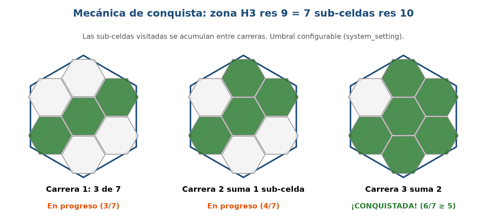
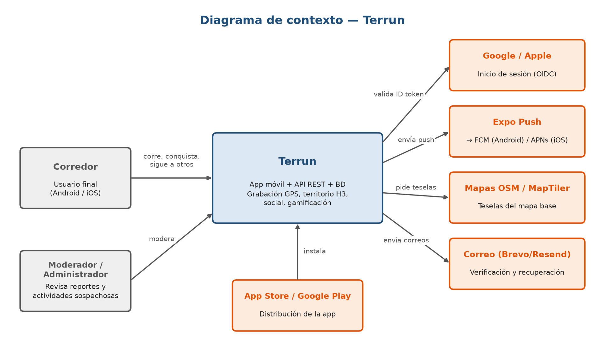
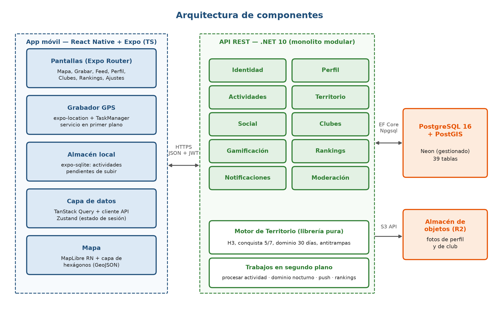
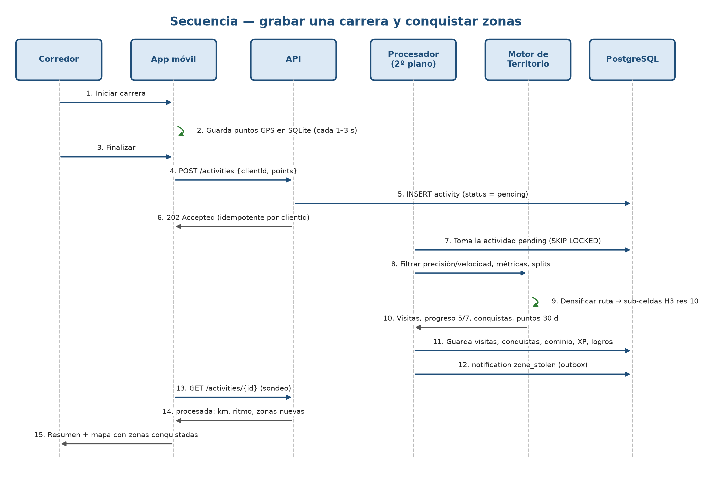
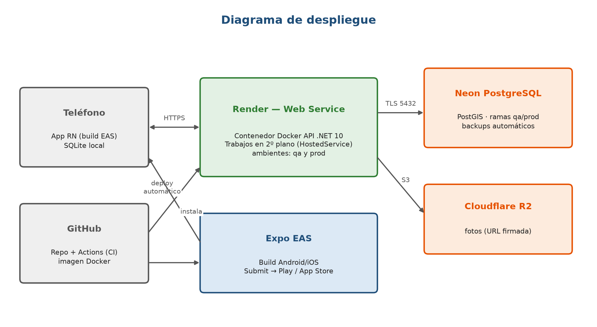

# Control de cambios del documento

| Versión | Fecha | Descripción del cambio | Autores / Responsables |
|---|---|---|---|
| 1.0 | 10/11/2026 | Versión inicial del documento para aprobación del proyecto ("Conquista tu Zona"). | Ashley (Scrum Master) / Diana (Product Owner) |
| 1.1 | 11/11/2026 | Adopción del nombre comercial Terrun (D-12) e incorporación de barrios reales con título de rey o reina del barrio sobre la malla de zonas (D-13). | Ashley (Scrum Master) |
| 1.2 | 11/11/2026 | Reestructuración según el índice oficial de la asignatura, redacción en lenguaje natural conciso, ajuste de roles del equipo (D-16) y priorización del MVP. | Diana (Product Owner) / Ashley (Scrum Master) |

## Equipo del proyecto

| Integrante | Rol en Scrum | Responsabilidad principal en el equipo |
|---|---|---|
| **Ashley** | Scrum Master | Coordinación ágil, arquitectura de servidor (Backend), base de datos, motor de territorio, seguridad y despliegue; asigna y revisa las funciones de servidor de Rowlis. |
| **Diana** | Product Owner | Visión del producto, gestión y priorización del Backlog, criterios de aceptación, validación con corredores y documentación. |
| **Jorge** | Equipo de desarrollo | Desarrollo móvil (experiencia de usuario y núcleo técnico): sistema de diseño, diseño visual de pantallas, grabación GPS, guardado sin internet y mapa interactivo. |
| **Rowlis** | Equipo de desarrollo | Desarrollo móvil y apoyo al servidor (Backend): estructura base de la app, pantallas de cuenta, perfil, muro básico, clubes, gamificación y rankings; apoyo en funciones puntuales del servidor. |
| **Rangelis** | Equipo de desarrollo | Aseguramiento de calidad (QA): plan de pruebas, casos de prueba por módulo, pruebas del servidor y seguimiento de defectos. |
| **Jaime** | Equipo de desarrollo | Aseguramiento de calidad (QA): pruebas de campo corriendo en calle con teléfonos reales, regresión y validación por entrega. |

# 1. Introducción

## 1.1 Propósito

El propósito de **Terrun** (*terra*, tierra, y *run*, correr) es resolver uno de los principales obstáculos del ejercicio urbano: **la falta de motivación y la monotonía**. Las aplicaciones deportivas tradicionales (como Strava o Nike Run Club) funcionan como bitácoras pasivas pensadas para quien busca récords de velocidad; para la mayoría de las personas, correr siempre por las mismas calles sin un estímulo inmediato provoca el abandono en las primeras semanas.

Bajo el lema **"Conquista tu zona · Cada carrera suma territorio"**, nuestra solución **transforma la ciudad real en un tablero de juego interactivo** donde cada salida a correr, trotar o caminar permite explorar, pintar y disputar zonas reales del mapa urbano, combinando la medición de un reloj deportivo con un juego de estrategia territorial y comunidad.

## 1.2 Público

La aplicación **Terrun** está dirigida a cuatro perfiles de usuarios urbanos:

1. **Corredores recreativos y principiantes:** personas que salen a caminar, trotar o correr y buscan una meta visual y alcanzable en cada salida (completar las calles de una zona cercana) en lugar de competir solo por velocidad.
2. **Corredores frecuentes y competitivos:** deportistas constantes que buscan **defender el dominio** de sus zonas en la ventana de los últimos 30 días, subir en el ranking y coronarse como **rey o reina de su barrio**.
3. **Clubes de running y grupos de entrenamiento:** comunidades deportivas o grupos de amigos que unen los recorridos de sus integrantes para expandir el territorio dominado por su club.
4. **Exploradores urbanos:** usuarios motivados por descubrir y coleccionar nuevas calles, parques y sectores de su ciudad.

## 1.3 Uso previsto

En la rutina del corredor, **Terrun** se utiliza en cuatro momentos:

1. **Antes de correr (estrategia en el mapa):** el corredor consulta el mapa de su sector para identificar qué zonas están libres, cuáles tiene en progreso y cuáles dominan otros corredores.
2. **Durante la carrera (grabación en segundo plano y sin internet):** inicia la actividad en dos toques y bloquea la pantalla; la app guarda el recorrido por GPS en la memoria local, aplica *auto-pausa* en paradas y emite avisos de voz por kilómetro.
3. **Al terminar (validación y conquista):** el servidor filtra la señal GPS, descarta tramos en vehículo, calcula las métricas deportivas e ilumina las **zonas conquistadas**, los **robos de dominio**, el título del barrio y la experiencia (**XP**) ganada.
4. **Entre entrenamientos (comunidad y seguimiento):** el usuario revisa el *Feed* de actividad, el mapa de su club, los rankings, sus medallas y su bandeja de notificaciones.

## 1.4 Lo que hacemos

Construimos una plataforma compuesta por una aplicación móvil para **Android e iOS** y un servidor central con motor geoespacial propio:

### 1. Dividimos la ciudad en una malla hexagonal de dos niveles
Dividimos el mapa en **zonas hexagonales** de unos 174 m de lado (0,10 km²). Para evitar que alguien conquiste una zona solo cruzándola por una avenida, cada zona se compone internamente de **7 sub-celdas pequeñas** (1 central y 6 alrededor).

### 2. Combinamos exploración personal y competencia activa
- **Conquista permanente (5 de 7 sub-celdas):** al pisar al menos **5 de las 7 sub-celdas** de una zona (en una o varias salidas), el corredor la conquista para siempre en su mapa personal.
- **Dominio competitivo (30 días):** quien sume más puntos de sub-celdas dentro de una zona en los **últimos 30 días** (mínimo 3 puntos) es su **dueño actual**; si otro corredor lo supera, **le roba la zona**.
- **Barrios reales:** agrupamos los hexágonos dentro de los barrios oficiales de la ciudad; quien domine más zonas dentro de un barrio (mínimo 3) recibe la corona de **rey o reina del barrio**.

### 3. Entregamos medición deportiva, juego limpio y comunidad
Calculamos gratuitamente distancia, ritmo (`min/km`), elevación, calorías, *splits* y récords; validamos cada ruta en el servidor contra trampas en vehículo (> 25 km/h); e integramos clubes, muro de actividad, niveles por **XP**, rachas, logros, retos y *rankings*.

## 1.5 Acrónimos y definiciones

### A. Conceptos del juego territorial y del running

| Término | Definición en Terrun |
|---|---|
| **Actividad** | Salida a correr, trotar o caminar grabada con el GPS del teléfono. |
| **Zona** | Hexágono grande del mapa (celda H3 nivel 9, unos 174 m de lado) que se conquista y disputa. |
| **Sub-celda** | Cada una de las **7 partes hexagonales pequeñas** (H3 nivel 10) que forman el interior de una Zona. |
| **Conquista (Regla 5 de 7)** | Logro personal **permanente** al pisar al menos **5 de las 7 sub-celdas** de una zona. |
| **Punto de zona** | Cada sub-celda distinta pisada en una actividad válida suma **1 punto** (máximo 7 por carrera en una zona). |
| **Dominio (30 días)** | Propiedad **temporal** de una zona: el dueño es quien suma más puntos en los **últimos 30 días** (mínimo 3; empate conserva al dueño). |
| **Robo de zona** | Ocurre cuando otro corredor supera los puntos de los últimos 30 días del dueño actual y toma el dominio. |
| **Barrio y Rey/Reina** | Sector oficial de la ciudad que agrupa zonas; quien domine más zonas en él (mínimo 3) lleva la corona del barrio. |
| **Ritmo (Pace)** | Minutos y segundos empleados para recorrer **1 kilómetro** (ej. `5:30 min/km`). |
| **Split (Parcial por km)** | Resumen individual de tiempo, ritmo y desnivel de cada kilómetro completado. |
| **Tiempo en movimiento** | Duración de la carrera descontando las pausas; se usa para calcular el ritmo real. |
| **Auto-pausa** | Pausa automática del cronómetro cuando el corredor se detiene y reanudación al volver a moverse. |
| **Actividad en revisión** | Cuarentena preventiva aplicada por el servidor a carreras con velocidades o ritmos sospechosos de vehículo. |
| **Racha semanal (Streak)** | Semanas consecutivas completando al menos una actividad válida. |
| **XP (Experiencia)** | Puntos ganados por kilómetros, conquistas, robos, logros y retos que determinan el **nivel** del corredor. |

### B. Acrónimos y términos técnicos

| Sigla o término | Significado | Qué representa en el proyecto |
|---|---|---|
| **HLD / LLD** | *High-Level / Low-Level Design* | **HLD:** este documento general; **LLD:** especificación técnica de tablas, endpoints y fórmulas. |
| **RF / RNF** | Requisito Funcional / No Funcional | **RF:** función del sistema; **RNF:** condición de calidad (precisión, batería, rapidez). |
| **P0 / P1 / P2** | Prioridades 0, 1 y 2 | **P0:** núcleo del MVP. **P1:** funciones importantes del ciclo académico. **P2:** expansión post-entrega. |
| **H3 (Uber H3)** | *Hierarchical Spatial Index* | Librería espacial que divide el mapa en hexágonos (nivel 9 para Zonas y nivel 10 para Sub-celdas). |
| **GPS / GPX** | *Global Positioning / GPS Exchange* | **GPS:** sensor de ubicación; **GPX:** formato estándar (`.gpx`) para exportar rutas. |
| **GeoJSON** | *Geographic JSON* | Formato estándar para enviar polígonos de hexágonos y barrios al mapa móvil. |
| **Offline-first y SQLite** | "Primero sin internet" / BD local | Guardado de puntos GPS en la base de datos interna del teléfono (**SQLite**) sin depender de señal. |
| **Servicio en primer plano** | *Foreground Service* | Permiso móvil con aviso fijo que evita que el sistema apague el GPS al bloquear la pantalla. |
| **Idempotencia** (`clientId`) | Envío único garantizado (UUID) | Código único por carrera que evita duplicados si la actividad se reenvía por fallos de red. |
| **Monolito Modular** | Arquitectura en .NET 10 | Un solo servidor central dividido internamente en módulos independientes por dominio. |
| **API REST y OpenAPI** | Interfaz web y catálogo Swagger | Comunicación HTTPS entre la app y el servidor documentada automáticamente. |
| **PostGIS** | Extensión espacial de PostgreSQL | Motor geográfico para indexar rutas y consultar zonas visibles en milisegundos. |
| **JWT y OIDC** | *JSON Web Token / OpenID Connect* | **JWT:** credencial cifrada de sesión; **OIDC:** protocolo de acceso social (Google/Apple). |
| **Ley 172-13** | Protección de Datos Personales (RD) | Ley dominicana que rige el consentimiento informado y la privacidad de los usuarios. |

# 2. Descripción general

## 2.1 Necesidades del usuario

| Tipo de usuario | Quién es | Qué necesita del sistema |
|---|---|---|
| **Corredor** | Usuario registrado que sale a caminar, trotar o correr. | • Iniciar la grabación en dos toques. • Medir distancia y ritmo con pantalla bloqueada y sin internet. • Conquistar y disputar zonas de su ciudad y su barrio. • Competir sin trampas en vehículo junto a su comunidad y su club. |
| **Visitante** | Persona que abre la app por primera vez sin cuenta. | • Entender la mecánica de Terrun y registrarse rápido conociendo cómo se protegen sus datos. |
| **Moderador** | Encargado de resguardar el juego limpio (etapa P2). | • Revisar carreras en cuarentena y reportes para aprobarlas o sancionarlas. |
| **Administrador** | Equipo técnico del producto. | • Ajustar los parámetros del juego (umbral 5/7, ventana de 30 días, velocidades y XP) en base de datos sin republicar la app. |

## 2.2 Dependencias y Asunciones

El sistema utiliza los servicios externos descritos en la **Sección 3.2** y parte de los siguientes supuestos y acuerdos:

| Código | Tipo | Descripción | Estado / Responsable |
|---|---|---|---|
| **S-01** | Asunción | Los desarrolladores móviles (Jorge y Rowlis) dominan **React y TypeScript**, haciendo de React Native + Expo la opción óptima. | **Confirmado (11/11/2026):** Decisión D-15. |
| **S-02** | Asunción | El equipo contará con acceso a Google Play Console y TestFlight para distribuir las versiones de prueba. | Planificado — **Diana** (Sprint 4). |
| **S-03** | Asunción | Los usuarios disponen de teléfonos con **Android 10+** o **iOS 16+** y conceden permiso de ubicación al grabar. | Cubierto en `RF-10`. |
| **P-01** | Pendiente | Recolectar al menos 15 respuestas de la encuesta a corredores para priorizar el alcance de `P1`. | **Completado (23 respuestas):** aplicado en 3.1 — **Diana**. |
| **P-02** | Pendiente | Confirmar con el profesor el formato y duración de la presentación final del 20 de enero. | En seguimiento — **Ashley**. |
| **P-03** | Pendiente | Calibrar en calle con corredores de prueba los valores iniciales de XP y umbrales antitrampas. | Planificado — **Diana y Jaime** (Sprint 3). |

# 3. Requisitos y características del sistema

## 3.1 Requisitos funcionales

**Leyenda de prioridades del proyecto:**
- **P0 (Imprescindible — Núcleo del MVP):** funciones obligatorias del bucle central que demuestran el propósito de la aplicación.
- **P1 (Importante):** funciones competitivas, comunitarias y de gamificación.
- **P2 (Futuro — Versión 2 post-entrega):** funciones de expansión comercial diseñadas para implementarse después de la entrega académica.

---

### Parte I — Módulos básicos de la aplicación

### Módulo 1 — Registro y autenticación

| Código | Nombre del RF | Descripción | Prioridad | Depende de |
|---|---|---|---|---|
| **RF-01** | **Registrar cuenta con correo** | Crear una cuenta con correo electrónico y contraseña segura (mínimo 10 caracteres), enviando un correo de verificación. | P0 | `RF-35` |
| **RF-02** | **Verificar correo electrónico** | Confirmar la titularidad del correo mediante el código o enlace recibido (vigencia de 24 horas) y permitir su reenvío. | P0 | `RF-01` |
| **RF-03** | **Iniciar sesión con correo** | Autenticar al corredor con su correo y contraseña, manteniendo la sesión segura en el teléfono (*SecureStore*) con renovación automática. | P0 | `RF-02` |
| **RF-04** | **Cerrar sesión activa** | Finalizar la sesión en el teléfono y revocar inmediatamente el pase de renovación (*refresh token*) en el servidor. | P0 | `RF-03` |
| **RF-05** | **Solicitar recuperación de contraseña** | Enviar al correo registrado un enlace o código temporal (vigencia de 1 hora y un solo uso) cuando el usuario olvida su clave. | P0 | `RF-01` |
| **RF-06** | **Restablecer contraseña con token** | Definir una nueva contraseña validando el código temporal recibido y revocar las sesiones abiertas del usuario. | P0 | `RF-05` |
| **RF-07** | **Iniciar sesión con Google** | Registrarse o entrar con un toque mediante una cuenta de Google (OIDC), vinculándola si el correo ya existe. | P2 | `RF-35` |
| **RF-08** | **Iniciar sesión con Apple** | Registrarse o entrar en iOS usando una cuenta de Apple (*Sign in with Apple*), validando su firma oficial en el servidor. | P2 | `RF-35` |

### Módulo 2 — Onboarding y permisos iniciales

| Código | Nombre del RF | Descripción | Prioridad | Depende de |
|---|---|---|---|---|
| **RF-09** | **Mostrar pantalla de bienvenida** | Presentar al visitante la introducción visual a Terrun y las opciones para registrarse o iniciar sesión. | P0 | — |
| **RF-10** | **Solicitar permiso de ubicación** | Explicar en español el uso del GPS (incluso con pantalla bloqueada) antes de lanzar el aviso del sistema operativo. | P0 | `RF-03` |
| **RF-11** | **Solicitar permiso de notificaciones** | Pedir autorización para enviar avisos emergentes (*push*) al teléfono fuera de la aplicación. | P2 | `RF-03` |

### Módulo 3 — Gestión de perfil y cuenta

| Código | Nombre del RF | Descripción | Prioridad | Depende de |
|---|---|---|---|---|
| **RF-12** | **Consultar perfil propio** | Mostrar al corredor sus datos personales, `@handle`, foto, nivel actual, récords y resumen de estadísticas propias. | P0 | `RF-03` |
| **RF-13** | **Consultar perfil de otro corredor** | Mostrar el perfil público de otro usuario y sus estadísticas territoriales y deportivas al seleccionarlo en el mapa, buscador o ranking. | P1 | `RF-03` |
| **RF-14** | **Editar datos personales del perfil** | Modificar nombre visible, `@handle`, biografía, ciudad, país y datos físicos (fecha de nacimiento, sexo, peso y estatura para calorías). | P0 | `RF-12` |
| **RF-15** | **Actualizar fotografía de perfil** | Subir o reemplazar la foto de perfil almacenándola en el servicio de archivos en la nube mediante URL segura firmada. | P1 | `RF-14` |
| **RF-16** | **Cambiar contraseña desde la cuenta** | Modificar la contraseña actual con sesión iniciada verificando primero la clave vigente. | P1 | `RF-03` |
| **RF-17** | **Exportar datos personales** | Descargar un archivo comprimido (`ZIP`) con la información del usuario en `JSON` y sus rutas en `GPX`. | P2 | `RF-03` |
| **RF-18** | **Eliminar cuenta de usuario** | Dar de baja definitiva la cuenta previa confirmación, eliminando datos personales y liberando las zonas dominadas. | P2 | `RF-03` |

### Módulo 4 — Navegación, pantalla principal y búsqueda

| Código | Nombre del RF | Descripción | Prioridad | Depende de |
|---|---|---|---|---|
| **RF-19** | **Navegar por pestañas principales** | Organizar la app en una barra inferior de 5 pestañas (*Mapa, Feed, Grabar, Clubes y Perfil*), abriendo el Mapa como inicio (*Home*) para grabar en dos toques. | P0 | `RF-03` |
| **RF-20** | **Consultar muro de actividad (Feed básico)** | Mostrar en la pestaña *Feed* la cronología de conquistas de zonas, reinados de barrio, logros y resúmenes de carrera del club sin exponer el trazo GPS privado de terceros. | P1 | `RF-19`, `RF-42` |
| **RF-20 (V2)** | **Ampliar muro de actividad con red de seguidores** | Actualizar el *Feed* en la segunda etapa para mostrar las actividades y rutas autorizadas de los corredores seguidos junto con sus *kudos* y comentarios. | P2 | `RF-20`, `RF-76` |
| **RF-21** | **Buscar corredores** | Encontrar a otros usuarios registrados escribiendo su nombre visible o su identificador `@handle`. | P1 | `RF-19` |
| **RF-22** | **Buscar clubes de corredores** | Encontrar clubes deportivos filtrando por su nombre o por la ciudad a la que pertenecen. | P1 | `RF-19` |

### Módulo 5 — Notificaciones

| Código | Nombre del RF | Descripción | Prioridad | Depende de |
|---|---|---|---|---|
| **RF-23** | **Registrar dispositivo para avisos Push** | Guardar el identificador del teléfono (*Expo Push Token*) al conceder permisos y desvincularlo al cerrar sesión. | P2 | `RF-11` |
| **RF-24** | **Enviar notificaciones Push al teléfono** | Emitir avisos emergentes al sistema operativo del teléfono cuando la aplicación está cerrada. | P2 | `RF-23` |
| **RF-25** | **Consultar bandeja de notificaciones** | Mostrar dentro de la aplicación el listado de avisos recibidos (robos de zona, coronas de barrio, logros y retos) y el contador de no leídos. | P1 | `RF-03` |
| **RF-26** | **Marcar notificaciones como leídas** | Cambiar el estado de una notificación individual o de toda la bandeja a leída, actualizando el contador. | P1 | `RF-25` |

### Módulo 6 — Configuración, ajustes y privacidad

| Código | Nombre del RF | Descripción | Prioridad | Depende de |
|---|---|---|---|---|
| **RF-27** | **Configurar unidades de medida** | Alternar entre el sistema métrico (`km`, `min/km`, `kg`, activo por defecto) y el sistema imperial (`mi`, `min/mi`, `lb`). | P2 | `RF-03` |
| **RF-28** | **Configurar auto-pausa y avisos de voz** | Activar o desactivar la pausa automática en paradas durante la carrera y los avisos de voz por kilómetro (`RF-39`). | P0 | `RF-03` |
| **RF-29** | **Configurar privacidad del perfil** | Definir si el perfil es público o privado (exigiendo aprobar manualmente a cada nuevo seguidor). | P2 | `RF-12` |
| **RF-30** | **Configurar visibilidad por defecto de rutas** | Elegir quién puede ver el mapa de las actividades nuevas: *Público, Solo seguidores o Privado (solo yo)*. | P2 | `RF-03` |
| **RF-31** | **Configurar preferencias de avisos** | Encender o silenciar individualmente cada categoría de notificación emergente (*push*). | P2 | `RF-11` |
| **RF-32** | **Gestionar zonas de privacidad del hogar** | Crear y eliminar áreas circulares alrededor de casa o trabajo para recortar el inicio y fin de las rutas frente a terceros. | P2 | `RF-03` |
| **RF-33** | **Bloquear y desbloquear usuarios** | Bloquear a un usuario (impidiendo visibilidad mutua), consultar la lista de bloqueados y desbloquearlo. | P2 | `RF-03` |

### Módulo 7 — Soporte legal y reporte de problemas

| Código | Nombre del RF | Descripción | Prioridad | Depende de |
|---|---|---|---|---|
| **RF-34** | **Consultar términos y política de privacidad** | Mostrar la versión vigente de los términos de uso y la política de privacidad conforme a la Ley 172-13. | P0 | — |
| **RF-35** | **Registrar aceptación de documentos legales** | Guardar constancia verificable de la versión, fecha y dirección IP con que el usuario aceptó los documentos legales. | P0 | `RF-34` |
| **RF-36** | **Reportar problemas, abusos o trampas** | Enviar un reporte sobre un usuario, actividad sospechosa, comentario o club indicando el motivo y detalle. | P2 | `RF-03` |

---

### Parte II — Módulos específicos que caracterizan a Terrun

### Módulo 8 — Grabación de actividades y métricas deportivas

| Código | Nombre del RF | Descripción | Prioridad | Depende de |
|---|---|---|---|---|
| **RF-37** | **Grabar recorrido con GPS en primer y segundo plano** | Registrar las coordenadas segundo a segundo tanto con la app abierta como con la pantalla bloqueada, mostrando un aviso de grabación activa. | P0 | `RF-10` |
| **RF-38** | **Pausar y reanudar grabación de actividad** | Pausar y reanudar el cronómetro manualmente o mediante *auto-pausa* al detenerse, abriendo un nuevo segmento de ruta al retomar la marcha. | P0 | `RF-28`, `RF-37` |
| **RF-39** | **Emitir avisos de voz por kilómetro** | Anunciar por voz la distancia, el tiempo acumulado y el ritmo del último kilómetro completado. | P1 | `RF-28`, `RF-37` |
| **RF-40** | **Almacenar recorrido localmente sin internet** | Guardar cada punto GPS en tiempo real en la base de datos local (`SQLite`), recuperando la carrera si la app se cierra. | P0 | `RF-37` |
| **RF-41** | **Sincronizar actividad con el servidor sin duplicados** | Subir la carrera con reintentos automáticos al recuperar conexión usando un código único (`clientId`) para evitar duplicados. | P0 | `RF-40` |
| **RF-42** | **Calcular métricas oficiales de la actividad** | Calcular en el servidor distancia oficial, tiempo total y en movimiento, ritmo promedio (`min/km`), velocidad máxima, elevación y calorías. | P0 | `RF-41` |
| **RF-43** | **Generar parciales por kilómetro (Splits)** | Desglosar automáticamente el tiempo, ritmo promedio y desnivel de cada kilómetro individual de la actividad. | P0 | `RF-42` |
| **RF-44** | **Mostrar resumen post-carrera** | Presentar al finalizar la carrera el mapa de la ruta, las métricas calculadas, las zonas conquistadas y la experiencia (**XP**) ganada. | P0 | `RF-42` |
| **RF-45** | **Consultar historial de actividades propias** | Mostrar el listado paginado de las actividades del corredor con filtros por fecha y tipo (*carrera, trote o caminata*). | P0 | `RF-42` |
| **RF-46** | **Consultar detalle y ruta de una actividad** | Mostrar la vista detallada de una carrera propia con su trazo sobre el mapa y su tabla de *splits* por kilómetro. | P0 | `RF-43`, `RF-45` |
| **RF-47** | **Consultar resúmenes de progreso por periodo** | Mostrar los totales acumulados de distancia, tiempo y carreras por semana, mes o año comparados con el periodo anterior. | P1 | `RF-45` |
| **RF-48** | **Editar información de una actividad** | Modificar el título, descripción, tipo de ejercicio o visibilidad de una actividad propia. | P2 | `RF-46` |
| **RF-49** | **Eliminar una actividad registrada** | Borrar una actividad propia revirtiendo sus visitas de sub-celdas, su XP y recalculando el dominio de las zonas afectadas. | P2 | `RF-46` |
| **RF-50** | **Detectar récords personales automáticamente** | Identificar tras cada carrera si el corredor logró su mejor tiempo en **1 km, 5 km, 10 km, 21,1 km o 42,2 km**, o su mayor distancia. | P1 | `RF-42` |

### Módulo 9 — Territorio, conquista hexagonal H3 y barrios

| Código | Nombre del RF | Descripción | Prioridad | Depende de |
|---|---|---|---|---|
| **RF-51** | **Visualizar mapa de zonas hexagonales por estado** | Mostrar sobre el mapa las zonas H3 (resolución 9) coloreadas según su estado (*libre, en progreso, conquistada, dominada por mí o por otro*). | P0 | `RF-19` |
| **RF-52** | **Registrar progreso de sub-celdas visitadas** | Convertir el trazo válido de cada carrera en sub-celdas H3 (resolución 10, de 0 a 6) y actualizar el progreso (de 7 partes) en cada zona. | P0 | `RF-42` |
| **RF-53** | **Otorgar conquista permanente de zona (Regla 5 de 7)** | Conceder la conquista definitiva de una zona al acumular al menos **5 de sus 7 sub-celdas** visitadas entre una o varias carreras. | P0 | `RF-52` |
| **RF-54** | **Calcular dominio competitivo de zona (30 días)** | Asignar como dueño actual de una zona a quien sume más puntos de sub-celdas en los **últimos 30 días** (mínimo 3 puntos; empate conserva al dueño). | P1 | `RF-52` |
| **RF-55** | **Recalcular vencimiento nocturno de dominio** | Descontar cada noche los puntos con más de 30 días de antigüedad, liberando o cambiando de dueño las zonas no defendidas. | P1 | `RF-54` |
| **RF-56** | **Notificar robo o pérdida de dominio de zona** | Registrar el evento territorial (*robo, defensa o pérdida*) y avisar en la bandeja del dueño anterior cuando le arrebatan su zona. | P1 | `RF-25`, `RF-54` |
| **RF-57** | **Consultar detalle y sub-celdas de una zona** | Mostrar al tocar un hexágono el dibujo de sus 7 sub-celdas con el progreso propio, su dueño actual y el top 5 de corredores en la zona. | P0 | `RF-51`, `RF-52` |
| **RF-58** | **Consultar historial de eventos de una zona** | Mostrar la cronología detallada de conquistas, defensas y robos ocurridos históricamente en una zona específica. | P2 | `RF-54`, `RF-57` |
| **RF-59** | **Consultar resumen territorial del corredor** | Mostrar el conteo y listado de zonas conquistadas por el usuario y su balance territorial en el mapa. | P0 | `RF-53` |
| **RF-60** | **Visualizar límites de barrios en el mapa** | Agrupar las zonas dentro de los polígonos de los barrios reales de la ciudad y dibujar sus bordes y nombres sobre el mapa. | P1 | `RF-51` |
| **RF-61** | **Coronar rey o reina del barrio** | Otorgar el título de rey o reina del barrio a quien domine más zonas dentro de él (mínimo 3 zonas), avisando cuando cambie la corona. | P1 | `RF-54`, `RF-60` |
| **RF-62** | **Consultar detalle y clasificación de un barrio** | Mostrar la ficha del barrio con su rey o reina actual, el top 10 de corredores por zonas dominadas y el aporte propio. | P1 | `RF-61` |

### Módulo 10 — Gamificación: experiencia (XP), logros, rachas y retos

| Código | Nombre del RF | Descripción | Prioridad | Depende de |
|---|---|---|---|---|
| **RF-63** | **Otorgar puntos de experiencia (XP)** | Acreditar XP al corredor por cada kilómetro válido, zona conquistada, dominio, robo, logro o reto completado, sin duplicar premios. | P0 | `RF-42`, `RF-53` |
| **RF-64** | **Calcular nivel de progresión del corredor** | Determinar el nivel actual del usuario según su XP acumulado y mostrar la barra de avance hacia el siguiente nivel. | P0 | `RF-63` |
| **RF-65** | **Contabilizar racha semanal de constancia** | Calcular cuántas semanas consecutivas lleva el corredor completando al menos una actividad válida y guardar su récord de racha. | P1 | `RF-42` |
| **RF-66** | **Desbloquear logros automáticamente** | Evaluar tras cada carrera si el corredor cumplió alguna medalla del catálogo (por distancia, conquistas, robos, racha o nivel) y otorgarla. | P1 | `RF-63` |
| **RF-67** | **Consultar catálogo y avance de logros** | Mostrar la galería de medallas obtenidas y pendientes con su porcentaje de avance. | P1 | `RF-66` |
| **RF-68** | **Inscribirse y avanzar en retos deportivos** | Unirse o abandonar retos con meta numérica y fecha límite, sumando automáticamente el avance de cada carrera realizada en el plazo. | P1 | `RF-42` |
| **RF-69** | **Consultar clasificación de un reto** | Mostrar la tabla de posiciones individual de todos los participantes inscritos dentro de un reto específico. | P2 | `RF-68` |

### Módulo 11 — Rankings y tablas de posiciones

| Código | Nombre del RF | Descripción | Prioridad | Depende de |
|---|---|---|---|---|
| **RF-70** | **Consultar rankings en vivo por métrica y alcance** | Mostrar las tablas de posiciones semanales y mensuales por *zonas conquistadas, zonas dominadas, distancia o XP*, filtrando por alcance e incluyendo la fila propia. | P1 | `RF-42`, `RF-53` |
| **RF-71** | **Consultar rankings históricos cerrados** | Guardar al cierre de cada semana y mes una instantánea de las tablas para consultar los ganadores de periodos pasados. | P2 | `RF-70` |

### Módulo 12 — Clubes de corredores y territorio grupal

| Código | Nombre del RF | Descripción | Prioridad | Depende de |
|---|---|---|---|---|
| **RF-72** | **Crear y editar un club de corredores** | Fundar un club definiendo su nombre, ciudad, descripción y foto, quedando su creador como administrador. | P1 | `RF-03` |
| **RF-73** | **Unirse y abandonar un club** | Integrarse a un club de corredores o abandonarlo en cualquier momento. | P1 | `RF-72` |
| **RF-74** | **Administrar miembros y roles del club** | Aprobar solicitudes en clubes cerrados, promover miembros a administradores o expulsar integrantes. | P2 | `RF-73` |
| **RF-75** | **Visualizar territorio dominado por el club** | Mostrar sobre el mapa las zonas dominadas en conjunto por los miembros activos del club y su resumen colectivo. | P1 | `RF-54`, `RF-73` |

### Módulo 13 — Interacción social entre corredores

| Código | Nombre del RF | Descripción | Prioridad | Depende de |
|---|---|---|---|---|
| **RF-76** | **Seguir y dejar de seguir a un corredor** | Seguir a corredores con cuenta pública, enviar solicitud a cuentas privadas y dejar de seguir en cualquier momento. | P2 | `RF-13` |
| **RF-77** | **Aprobar o rechazar solicitudes de seguimiento** | Aceptar o rechazar las solicitudes pendientes en perfiles configurados como privados. | P2 | `RF-29`, `RF-76` |
| **RF-78** | **Consultar listas de seguidores y seguidos** | Mostrar el listado paginado de las personas que siguen a un corredor y de aquellas a las que él sigue. | P2 | `RF-76` |
| **RF-79** | **Dar y quitar kudos en una actividad** | Otorgar o retirar un aplauso deportivo (*kudos*) en una actividad visible y consultar quiénes lo dieron. | P2 | `RF-20 (V2)`, `RF-46` |
| **RF-80** | **Publicar y eliminar comentarios en una actividad** | Escribir comentarios de apoyo en actividades visibles y eliminar comentarios propios. | P2 | `RF-20 (V2)`, `RF-46` |

### Módulo 14 — Equipamiento deportivo y exportación de rutas

| Código | Nombre del RF | Descripción | Prioridad | Depende de |
|---|---|---|---|---|
| **RF-81** | **Registrar y editar zapatillas** | Dar de alta pares de zapatillas con marca, modelo, alias, kilometraje previo y límite de retiro (700 km por defecto). | P2 | `RF-03` |
| **RF-82** | **Acumular kilometraje y retirar zapatillas** | Sumar la distancia de cada carrera a la zapatilla asociada, alertar al llegar a su límite y marcarla como retirada. | P2 | `RF-42`, `RF-81` |
| **RF-83** | **Exportar recorrido de actividad en GPX** | Generar y descargar el archivo estándar `.gpx` de una actividad propia para usarlo en relojes o visores externos. | P2 | `RF-46` |

### Módulo 15 — Integridad del juego (Antitrampas), moderación y configuración

| Código | Nombre del RF | Descripción | Prioridad | Depende de |
|---|---|---|---|---|
| **RF-84** | **Descartar puntos GPS inexactos y saltos irreales** | Filtrar automáticamente los puntos con error mayor a 30 m o saltos de más de 200 m en menos de 5 s antes de medir la distancia. | P0 | `RF-41` |
| **RF-85** | **Excluir tramos realizados en vehículo** | Detectar los segmentos cuya velocidad supere el límite configurado (25 km/h) para que no sumen distancia ni territorio. | P0 | `RF-84` |
| **RF-86** | **Poner en cuarentena actividades sospechosas** | Marcar en estado *en revisión* las carreras con ritmo sobrehumano (< 2:30 min/km) o más del 20 % en vehículo, excluyéndolas del mapa. | P1 | `RF-85` |
| **RF-87** | **Resolver actividades en revisión** | Permitir a un moderador inspeccionar las actividades en cuarentena y aprobarlas o rechazarlas desde un panel administrativo. | P2 | `RF-86` |
| **RF-88** | **Resolver reportes de la comunidad y sancionar** | Atender reportes abiertos, ocultar contenido infractor y suspender o reactivar cuentas que incumplan las normas. | P2 | `RF-36` |
| **RF-89** | **Registrar auditoría inalterable de seguridad** | Guardar en bitácora (`audit_log`) cada cambio de rol, suspensión, baja de cuenta, resolución de reporte o ajuste de parámetros. | P2 | `RF-03` |
| **RF-90** | **Administrar parámetros dinámicos del motor** | Consultar y actualizar en base de datos (`system_setting`) las reglas del juego (umbral 5 de 7, ventana de 30 días, velocidades y XP) sin valores fijos en código. | P0 | — |

---

## 3.2 Requisitos de interfaz externa

### 1. Interfaces de usuario y hardware del dispositivo
- **Interfaz móvil:** pantallas en español claro con alto contraste visual (modo claro `#EDF1EE` y oscuro `#0D1512`) y botones principales de mínimo 44×44 puntos para operarse fácilmente en movimiento.
- **Sensores y recursos locales:** uso del chip GPS mediante un *servicio en primer plano* (para no interrumpirse con pantalla bloqueada), base de datos interna `SQLite` para almacenamiento sin internet y salida de audio para avisos por kilómetro.

### 2. Interfaces de software (Servicios externos)

| Servicio externo | Propósito en Terrun | Mecanismo de conexión |
|---|---|---|
| **MapTiler / OpenStreetMap** | Mostrar el plano de calles y parques de la ciudad. | Descarga de teselas vectoriales desde **MapLibre** por HTTPS. |
| **Brevo / Resend** | Enviar correos de verificación de cuenta y recuperación de clave. | Solicitud API HTTPS desde el servidor con llave privada. |
| **Cloudflare R2** | Almacenar fotos de perfil e imágenes de clubes. | Subida y lectura mediante permisos temporales (*URL firmadas*). |
| **Google y Apple (Etapa P2)** | Inicio de sesión social en la segunda versión. | Validación de firma oficial de *ID Token* (OIDC) en el servidor. |
| **Expo Push (Etapa P2)** | Envío de notificaciones emergentes fuera de la app. | Despacho por HTTPS desde el servidor hacia Google FCM y Apple APNs. |

### 3. Interfaces de comunicación
- **Protocolo y formatos:** comunicación cifrada por **HTTPS (TLS)** en formato **JSON**; polígonos geográficos en **GeoJSON** y exportación de rutas en **GPX 1.1** (usando internamente metros, segundos y hora UTC).

---

## 3.3 Características del sistema (Arquitectura a utilizar)

### 1. Arquitectura Cliente-Servidor con Monolito Modular

El sistema se organiza en tres bloques: una **aplicación móvil offline-first** (que graba la carrera en memoria local sin depender de internet), un **servidor central en .NET 10** estructurado como *Monolito Modular* (que aloja el motor matemático `Terrun.Engine` para validar rutas y calcular hexágonos H3) y una **base de datos espacial PostgreSQL 16 + PostGIS**.

| Componente | Tecnología elegida | Alternativas | Motivo de elección |
|---|---|---|---|
| **Aplicación móvil** | **React Native + Expo (TypeScript)** | Flutter; PWA | Un solo código para Android e iOS, soporte real de GPS en segundo plano y dominio previo de React en el equipo. |
| **Mapa interactivo** | **MapLibre + OpenStreetMap** | Google Maps | Código abierto, gratuito y capaz de dibujar cientos de hexágonos con fluidez. |
| **GPS y datos locales** | **expo-location + expo-sqlite** | Memoria volátil | Mantiene viva la grabación con pantalla apagada y asegura los puntos en disco local. |
| **Servidor (Backend)** | **.NET 10 Web API + EF Core 10** | NestJS, FastAPI | Alto rendimiento en cálculo geoespacial y experiencia previa comprobada en el equipo. |
| **Malla de zonas** | **Uber H3** (`pocketken.H3` / `h3-js`) | Cuadrícula propia | División uniforme donde cada zona (nivel 9) contiene exactamente 7 sub-celdas (nivel 10). |
| **Base de datos** | **PostgreSQL 16 + PostGIS (Neon)** | MongoDB, SQL Server | Estándar para consultas espaciales de rutas y polígonos en milisegundos. |
| **Nube y entrega** | **Render + GitHub Actions + EAS** | Despliegue manual | Automatiza las pruebas, el despliegue del servidor y la generación de instaladores móviles. |

### 2. Flujo de procesamiento de una carrera

1. **Captura local y subida única:** el teléfono guarda los puntos GPS en `SQLite` durante el recorrido y, al finalizar con conexión, envía el paquete identificado con su código único (`UUID`) para evitar duplicados.
2. **Validación y cálculo en el servidor:** el servidor recibe la ruta de inmediato y, en segundo plano, descarta rebotes de GPS o tramos en vehículo (> 25 km/h), calcula las sub-celdas H3 visitadas, actualiza conquistas (5 de 7), dominio de 30 días, reinados de barrio, XP, logros y rankings, y devuelve el resumen al corredor.

### 3. Ambientes de trabajo y despliegue

- **Ambiente Local:** en el equipo de cada desarrollador para programar y ejecutar pruebas unitarias sin afectar al resto.
- **Ambiente de Pruebas (QA):** actualizado automáticamente en **Render** y **Neon** al integrar cambios aprobados en GitHub, donde Rangelis y Jaime validan cada entrega.
- **Ambiente de Producción:** versión estable para la demostración final y los corredores reales en **Google Play** y **App Store (TestFlight)**.

---

## 3.4 Requisitos no funcionales

| Código | Aspecto de calidad | Criterio que debe cumplir el sistema |
|---|---|---|
| **RNF-01** | **Precisión deportiva** | Variación máxima del **3 %** en distancia frente a una ruta medida al aire libre. |
| **RNF-02** | **Grabación en segundo plano** | Registro continuo durante al menos **2 horas** con la pantalla bloqueada sin cortes del sistema operativo. |
| **RNF-03** | **Consumo de batería** | Gasto no mayor al **10 % de batería por hora** de grabación activa en un teléfono de gama media. |
| **RNF-04** | **Tiempos de respuesta** | Consultas habituales en menos de **500 ms** (p95) y procesamiento completo de una carrera en menos de **10 segundos**. |
| **RNF-05** | **Fluidez del mapa** | Carga de zonas visibles en menos de **1 segundo**, soportando hasta 2.000 hexágonos en pantalla. |
| **RNF-06** | **Seguridad** | Comunicación cifrada por HTTPS, contraseñas protegidas con hash irreversible y sesiones mediante tokens JWT de corta duración. |
| **RNF-07** | **Privacidad (Ley 172-13)** | Cumplimiento de la ley dominicana de datos personales: consentimiento informado y prohibición de exponer ubicaciones en vivo. |
| **RNF-08** | **Disponibilidad** | Servidor en línea al menos el **99 % del tiempo** durante el periodo de pruebas y demostración. |
| **RNF-09** | **Compatibilidad móvil** | Operación en teléfonos **Android 10+** e **iPhone con iOS 16+**. |
| **RNF-10** | **Usabilidad** | Inicio de grabación en máximo **2 toques** desde la pantalla principal, con interfaz íntegra en español. |
| **RNF-11** | **Cobertura de pruebas** | Al menos el **80 %** de las reglas del motor de territorio verificadas con pruebas unitarias automáticas. |
| **RNF-12** | **Escalabilidad** | Diseño preparado para soportar hasta **10.000 corredores activos** sin cambios de arquitectura. |

# 4. Anexos

## Anexo A — Parámetros iniciales de antitrampas y experiencia (XP)

### A.1 Reglas iniciales contra trampas

| Condición evaluada | Límite inicial | Acción automática del servidor |
|---|---|---|
| **Señal GPS inexacta** | Error mayor a **30 m** | Descarta el punto antes de medir distancia o zonas. |
| **Salto irreal de GPS** | Más de **200 m en menos de 5 s** | Ignora el salto por rebote de señal. |
| **Tramo en vehículo** | Velocidad mayor a **25 km/h** | El segmento no suma distancia ni territorio. |
| **Ritmo sobrehumano** | Promedio menor a **2:30 min/km** (o > 20 % en vehículo) | Pone la actividad *en revisión* (cuarentena) fuera del mapa. |
| **Actividad muy corta** | Duración menor a **3 minutos** | Se guarda en el historial, pero no otorga territorio. |
| **Carreras simultáneas** | Horarios superpuestos del mismo usuario | Rechaza la segunda actividad para evitar duplicidad. |

### A.2 Tabla inicial de puntos de experiencia (XP)

| Acción lograda por el corredor | Recompensa inicial |
|---|---|
| Cada **kilómetro válido** recorrido | **+10 XP** |
| **Conquistar una zona** por primera vez (5 de 7 sub-celdas) | **+50 XP** |
| **Tomar el dominio** de una zona libre (30 días) | **+30 XP** |
| **Robarle el dominio** de una zona a otro corredor | **+40 XP** |
| Desbloquear un **logro** o completar un **reto** | **+50 a +500 XP** (según dificultad) |

## Anexo B — Estrategia de calidad y pruebas (QA)

### B.1 Niveles de prueba y herramientas

| Nivel de prueba | Qué se verifica | Herramienta | Responsable |
|---|---|---|---|
| **Unitarias del motor** | Fórmulas de distancia, conquista 5/7, dominio de 30 días, barrios, XP y antitrampas contra casos calculados a mano. | xUnit (.NET) | Ashley y Rangelis |
| **Integración y BD** | Registro, sesiones, subida de carreras y consultas espaciales sobre PostgreSQL + PostGIS real. | xUnit + Testcontainers | Ashley y Rowlis |
| **Contrato de API** | Casos válidos y de error de cada operación del servidor en el ambiente de QA. | Bruno / Postman | Rangelis |
| **Componentes móviles** | Máquina de estados del grabador, cola de subida sin internet y pantallas clave. | Jest + Testing Library | Jorge y Rowlis |
| **Campo en calle** | Precisión (< 3 %), pantalla bloqueada, consumo de batería y modo avión en rutas medidas de 1 km y 5 km. | Teléfonos Android e iOS | Jaime (+ corredores) |
| **Regresión y aceptación** | Flujos completos antes de cada reunión semanal y validación de criterios de aceptación. | Maestro (E2E) + revisión PO | Rangelis, Jaime y Diana |

### B.2 Criterio de tarea terminada (Definition of Done)

Una historia se considera terminada cuando su código fue aprobado en *Pull Request* con pruebas automáticas en verde, funciona en Android e iOS sin valores fijos ni secretos expuestos, fue validada en QA por alguien distinto a su autor y quedó registrada en `ESTADO.md` y `BITACORA.md`.

## Anexo C — Plan de entregas, responsabilidades (RACI) y riesgos

### C.1 Calendario de Sprints e hitos de control

Trabajamos en sprints semanales (de viernes a viernes), con **congelamiento de código el miércoles 6 de enero de 2027** y dos semanas exclusivas de QA antes de la entrega final del **miércoles 20 de enero de 2027**:

| Sprint | Fechas | Meta principal de la entrega | Revisión (Weekly) |
|---|---|---|---|
| **S0** | 10–13 nov | Entrega de HLD y LLD; repositorio, CI, esqueletos y encuesta a corredores. | Vie 13 nov |
| **S1** | 14–20 nov | Registro, inicio de sesión, perfil, ambiente QA y **prueba real de GPS en segundo plano**. | Vie 20 nov |
| **S2** | 21–27 nov | Grabador completo, guardado en `SQLite` sin internet, subida única, métricas, *splits* e historial. | Vie 27 nov |
| **S3** | 28 nov–4 dic | **Motor de territorio P0:** sub-celdas H3, conquista (5 de 7), mapa coloreado, detalle de zona y XP/nivel. | Vie 4 dic |
| **S4** | 5–11 dic | **Cierre de P0 en producción e inicio de P1:** despliegue en producción, dominio de 30 días, robos y rankings. | Vie 11 dic |
| **S5** | 12–18 dic | **Comunidad y barrios (P1):** clubes de corredores, mapa de club, barrios con rey/reina, Feed básico y bandeja de avisos. | Vie 18 dic |
| **S6** | 19–23 dic | **Gamificación completa (P1):** logros automáticos, racha semanal, retos, récords personales y avisos de voz. | Mié 23 dic |
| **S7** | 26–30 dic | Estabilización general, pulido de interfaz, pruebas integrales de seguridad y preparación de tiendas. | Mié 30 dic |
| **S8** | 31 dic–6 ene | Cierre de defectos, **congelamiento de código (6 de enero)** y apertura de prueba cerrada con 12+ corredores. | — |
| **QA 1 y 2** | 7–19 ene | Ciclo completo de pruebas de campo, regresión E2E, corrección de defectos y ensayo de la demostración. | Vie 8 y 15 ene |
| **Entrega** | **Mié 20 ene** | **Presentación y demostración final del proyecto.** | — |

**Hitos de control del proyecto:**

| Fecha | Hito crítico | Plan de contingencia si no se cumple |
|---|---|---|
| **11 nov** | HLD y LLD entregados | Prioridad máxima del equipo antes de iniciar código. |
| **20 nov** | GPS en segundo plano validado en Android e iOS | Modo de respaldo grabando en primer plano con pantalla activa mientras se corrige. |
| **4 dic** | Conquista 5/7 operando de punta a punta | Dedicación exclusiva al motor territorial antes de abrir módulos competitivos P1. |
| **11 dic** | Núcleo P0 completo en producción | Las funciones P1 de menor prioridad pasan automáticamente a la etapa P2. |
| **6 ene** | Congelamiento de código | Ninguna función nueva entra después de esta fecha; foco exclusivo en calidad y estabilidad. |

### C.2 Matriz de responsabilidades (RACI)

*(R = Ejecuta · A = Aprueba / Responde · C = Consultado · I = Informado)*

| Actividad o entregable | Ejecuta (R) | Aprueba (A) | Consultado (C) | Informado (I) |
|---|---|---|---|---|
| Arquitectura, base de datos y contrato de API | Ashley | Ashley | Jorge, Rowlis | Todo el equipo |
| Priorización del Backlog y criterios de aceptación | Diana | Diana | Ashley | Todo el equipo |
| Parámetros y reglas del juego territorial | Ashley | Diana | Equipo y corredores | Todo el equipo |
| Experiencia de usuario (UX/UI), sistema de diseño y mapa | Jorge | Diana | Ashley, Rowlis | Todo el equipo |
| Estructura móvil, pantallas de módulos y apoyo en Backend | Rowlis | Ashley / Diana | Jorge | Todo el equipo |
| Validación de calidad (API y pruebas de campo) | Rangelis, Jaime | Diana | Ashley | Todo el equipo |
| Publicación en tiendas y cierre de versión | Ashley, Jorge | Diana | Jaime | Todo el equipo |

### C.3 Matriz de riesgos y mitigación

| Código | Riesgo identificado | Prob. | Impacto | Estrategia de prevención y mitigación |
|---|---|---|---|---|
| **R-01** | Corte del GPS en segundo plano por ahorro de batería (Xiaomi, Samsung, iOS). | Media | Alto | Prueba de campo de 30 min en el Sprint 1, uso de *Foreground Service* con aviso fijo y guía en pantalla para excluir la app del ahorro agresivo. |
| **R-02** | Demora en la revisión de Google Play por permisos de ubicación. | Media | Alto | Usar permiso de ubicación *"mientras se usa la app"* combinado con servicio en primer plano visible y declarar su propósito deportivo en la ficha. |
| **R-03** | Sobrecarga de desarrollo en el servidor (Backend). | Alta | Alto | Enfoque estricto en P0/P1 para el MVP, apoyo puntual de Rowlis en el servidor revisado por Ashley (D-16) y recorte automático a P2 el 11 de diciembre. |
| **R-04** | Reducción de disponibilidad del equipo durante Navidad y Año Nuevo. | Alta | Medio | Sprints 6 y 7 planificados con menor carga y reuniones adelantadas a los miércoles 23 y 30 de diciembre. |
| **R-05** | Trampas en vehículo (carro, motocicleta) o saltos de GPS falso. | Media | Medio | Validación exclusiva en el servidor: descarte de tramos > 25 km/h y cuarentena automática para ritmos < 2:30 min/km. |
| **R-06** | Requisito de Google Play de 12 probadores durante 14 días seguidos. | Alta | Medio | Reclutamiento anticipado de 12+ corredores y apertura de la prueba cerrada el 6 de enero, en paralelo con las dos semanas de QA. |
| **R-07** | Costos inesperados en servicios de nube o mapas. | Baja | Medio | Uso de capas gratuitas (Neon, Cloudflare R2, MapTiler/OSM, Expo) y control de límites de peticiones. |
| **R-08** | Exposición involuntaria de la ubicación privada de los corredores. | Baja | Alto | Cumplimiento de la Ley 172-13: sin ubicación en tiempo real y Feed básico en P1 sin exponer trazos GPS privados de terceros. |
| **R-09** | Caída de fluidez en el mapa al dibujar cientos de hexágonos. | Media | Medio | Carga acotada al área visible de la pantalla (máximo 2.000 hexágonos por consulta) y simplificación geométrica. |
