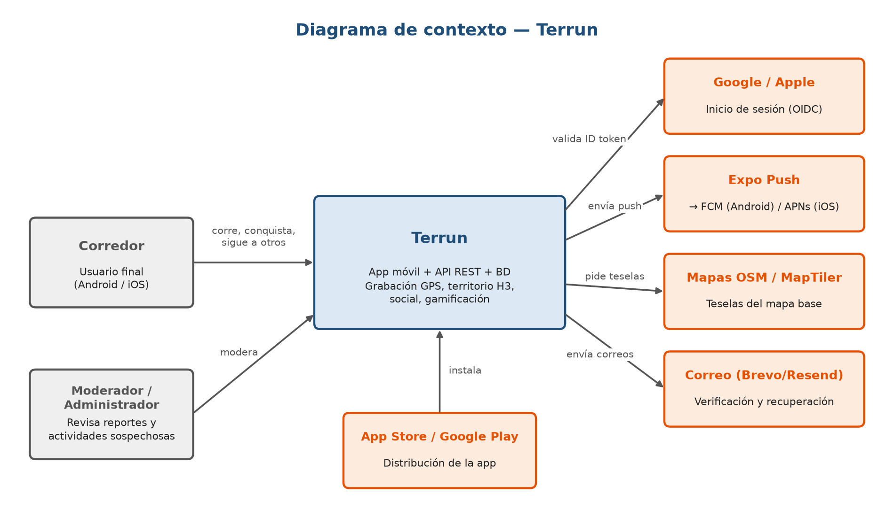
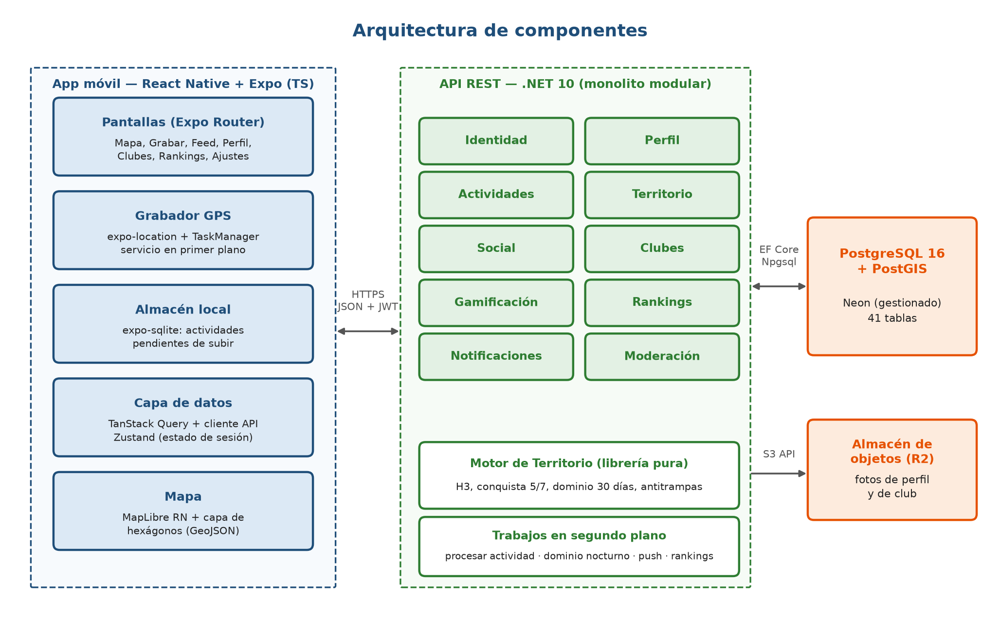
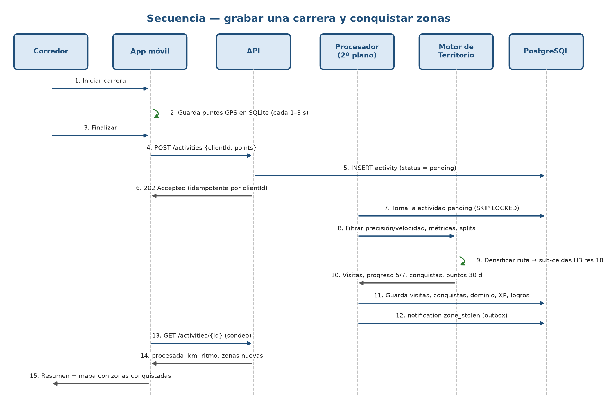
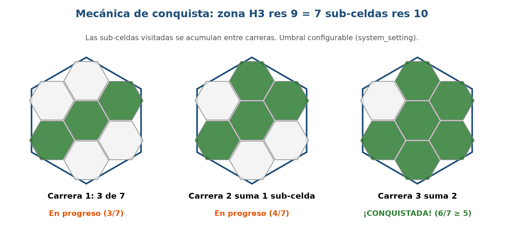
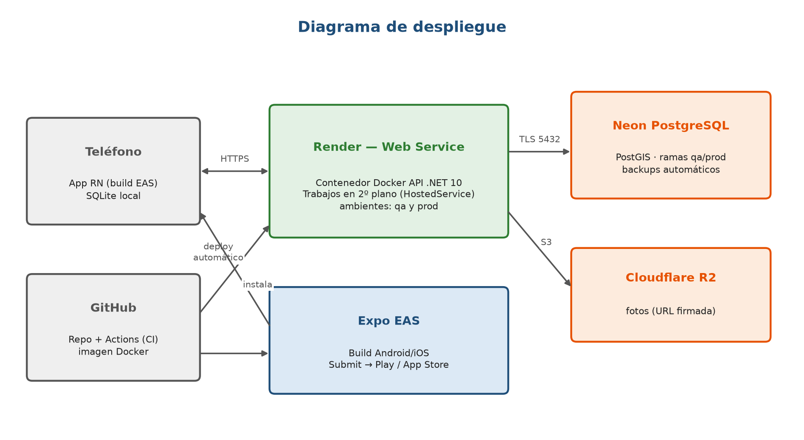

# Control del documento

| Versión | Fecha | Descripción | Responsable |
|---|---|---|---|
| 1.0 | 11/11/2026 | Versión inicial para aprobación del proyecto | Ashley (Scrum Master) / Diana (Product Owner) |
| 1.1 | 11/11/2026 | Barrios sobre la malla de zonas: rey o reina del barrio (D-13) | Ashley |

**Equipo**

| Integrante | Rol Scrum | Rol técnico |
|---|---|---|
| Ashley | Scrum Master | Ingeniera Full Stack — Backend, base de datos, motor de territorio, seguridad y despliegue |
| Diana | Product Owner | Dueña del backlog, prioridades, criterios de aceptación, validación con usuarios y documentación |
| Jorge | Equipo de desarrollo | Ingeniero Front — Grabación GPS, almacenamiento local, mapa y capa de territorio |
| Rowlis | Equipo de desarrollo | Ingeniero Front — Experiencia de usuario: cuenta, perfil, social, clubes, gamificación |
| Rangelis | Equipo de desarrollo | QA — Plan y casos de prueba, pruebas de API, registro de defectos |
| Jaime | Equipo de desarrollo | QA — Pruebas de campo, regresión, validación de cada sprint |

# 1. Introducción

## 1.1 Propósito

Este documento describe el diseño de alto nivel de **Terrun** (de *terra* + *run*), una aplicación móvil deportiva y gamificada para corredores. Define la visión del producto, el alcance, los actores, los requisitos de alto nivel, la arquitectura, las decisiones tecnológicas, la estrategia de seguridad, calidad y despliegue, y el plan de entrega. El detalle de implementación (modelo de datos completo, contrato de API, algoritmos y estructura de código) está en el documento complementario **LLD (Diseño de Bajo Nivel)**.

## 1.2 Problema

Mantener la constancia en la actividad física es difícil: la mayoría de las personas abandona una rutina de carrera en las primeras semanas por falta de motivación. Las aplicaciones de running existentes registran métricas (distancia, ritmo), pero ofrecen poca motivación lúdica para salir a explorar y volver a correr.

## 1.3 Solución

Terrun convierte la ciudad en un tablero de juego. El mapa real está dividido en **zonas hexagonales**. Cuando el usuario trota o corre y recorre una zona, la va **conquistando**; si otro corredor la recorre más que él, se la puede **arrebatar**. A esto se suman las funciones que los corredores esperan de una app de mercado: registro preciso de la actividad, métricas y récords, red social, clubes, retos, logros y rankings.

**Nombre y lema:** el producto se llama **Terrun**. La propuesta presentada en la asignatura, "Conquista tu zona", se conserva como lema de la app.

**Propuesta de valor:** "Cada carrera suma territorio". Motiva a correr con frecuencia (defender tus zonas), a explorar rutas nuevas (conquistar zonas nuevas) y a correr en grupo (territorio de club).

## 1.4 Objetivos del producto

1. Registrar actividades de carrera con precisión comparable a las apps líderes del mercado, incluso con la pantalla bloqueada y sin conexión.
2. Ofrecer una mecánica de territorio justa, verificable y resistente a trampas.
3. Fomentar la constancia mediante gamificación (XP, niveles, rachas, logros, retos) y competencia social (rankings, dominio de zonas, clubes).
4. Estar publicada y operativa para la entrega académica, y quedar preparada para su comercialización en App Store y Google Play.

## 1.5 Requisitos de la asignatura y cómo se cumplen

| Requisito del curso | Cómo lo cumple el proyecto |
|---|---|
| Sistema o aplicación con un fin específico, construido en equipo | App para motivar la actividad física mediante la conquista de zonas reales; equipo de 6 con roles Scrum |
| Ingresar o capturar datos y almacenarlos en una BD de su elección | Captura GPS, actividades, territorio, interacciones sociales; PostgreSQL + PostGIS (41 tablas) |
| Publicación mediante web service o app store | API REST publicada como servicio web (Render) y app distribuida por Google Play (prueba interna/cerrada) y App Store (TestFlight) |
| HLD aprobado antes de la fecha establecida | Este documento (11/11/2026), acompañado del LLD |
| Weeklys de avance e impedimentos por sprint | Sprints semanales de viernes a viernes con weekly cada viernes (§11) |
| Scrum Master por grupo | Ashley (Scrum Master), con Diana como Product Owner |

## 1.6 Definiciones

| Término | Definición |
|---|---|
| Actividad | Una sesión de carrera, trote o caminata registrada con GPS |
| H3 | Sistema de indexación geoespacial jerárquico de celdas hexagonales (código abierto, creado por Uber) |
| Zona | Celda hexagonal H3 de resolución 9 (≈0,105 km², ≈174 m de lado); unidad del territorio |
| Sub-celda | Cada una de las 7 celdas H3 de resolución 10 que componen una zona |
| Conquista | Hito personal: el usuario ha recorrido al menos 5 de las 7 sub-celdas de una zona (acumulado entre carreras) |
| Dominio | Propiedad competitiva de una zona: la tiene el usuario con más puntos de zona en los últimos 30 días |
| Punto de zona | Una sub-celda distinta recorrida en una actividad dentro de esa zona |
| Robo | Cambio de dueño de una zona cuando otro usuario supera los puntos del dueño actual |
| Barrio | Área con nombre real de la ciudad (Naco, Piantini…) que agrupa zonas; no se conquista directamente |
| Rey o reina del barrio | El usuario que domina más zonas de un barrio |
| XP | Puntos de experiencia que determinan el nivel del usuario |
| P0 / P1 / P2 | Prioridades: P0 imprescindible para la demo, P1 nivel de mercado, P2 posterior a la entrega |

# 2. Alcance

## 2.1 Dentro del alcance (diseñado completo)

El diseño cubre 13 módulos. Todos tienen modelo de datos y endpoints definidos en el LLD; se construyen por prioridad (§11).

| # | Módulo | Capacidades principales | Prioridad |
|---|---|---|---|
| M1 | Identidad y cuenta | Registro con correo, inicio de sesión con Google y Apple, verificación de correo, recuperación de contraseña, sesiones, eliminación de cuenta y exportación de datos, aceptación de términos | P0 / P1 |
| M2 | Perfil y preferencias | Perfil público, datos físicos para calorías, unidades, auto-pausa, avisos de voz, privacidad, zonas de privacidad | P0 / P1 |
| M3 | Actividades | Grabación GPS en primer y segundo plano, pausa y auto-pausa, distancia, ritmo, elevación, calorías, splits por km, historial, récords personales, exportación GPX | P0 |
| M4 | Equipamiento | Registro de zapatillas, kilometraje acumulado, aviso de cambio | P1 |
| M5 | Territorio | Mapa de zonas, conquista personal (5 de 7), dominio competitivo de 30 días, robos y defensas, historial de la zona, barrios con rey o reina | P0 / P1 |
| M6 | Social | Seguir usuarios, feed de actividades, kudos, comentarios, bloqueo, reportes | P1 |
| M7 | Clubes | Crear y unirse a clubes, territorio y ranking del club | P1 |
| M8 | Gamificación | XP y niveles, rachas, logros, retos mensuales | P1 |
| M9 | Rankings | Semanal, mensual, por ciudad, por club y entre amigos; histórico | P0 / P1 |
| M10 | Notificaciones | Push y bandeja interna: zona robada, kudos, comentarios, retos, logros | P1 |
| M11 | Integraciones | Exportar GPX (P1); importar desde Strava/Garmin y salud del dispositivo (P2) | P1 / P2 |
| M12 | Moderación y antitrampas | Detección de actividades sospechosas, revisión de reportes, auditoría | P1 |
| M13 | Configuración del motor | Parámetros del juego (umbral de conquista, ventana de dominio, límites antitrampas) sin valores fijos en el código | P0 |

## 2.2 Fuera del alcance de la entrega académica (P2 — fase comercial)

- Importación de actividades desde Strava, Garmin o archivos GPX/FIT.
- Integración con Apple HealthKit y Android Health Connect (frecuencia cardíaca, pasos).
- Fotos en actividades.
- Temporadas competitivas con reinicio de territorio.
- Planes de entrenamiento y suscripción premium.
- Panel web de administración (durante el curso la moderación se opera desde la API documentada en Swagger).

## 2.3 Validación con usuarios reales

El equipo cuenta con un grupo de corredores que responderá una encuesta durante el Sprint 1. Sus respuestas ajustan el **orden** de las funcionalidades P1 (no el diseño). El mismo grupo es candidato a ser el primer club de la app y parte de los testers de la prueba cerrada de Google Play.

# 3. Actores y sistemas externos

| Actor / Sistema | Descripción | Interacción |
|---|---|---|
| Corredor | Usuario registrado de la app | Graba actividades, conquista zonas, interactúa socialmente, participa en clubes y retos |
| Visitante | Persona sin cuenta | Ve la pantalla de bienvenida, se registra o inicia sesión |
| Moderador | Corredor con permisos de moderación | Revisa reportes y actividades marcadas como sospechosas |
| Administrador | Equipo del producto | Gestiona parámetros del motor, logros, retos y roles |
| Google / Apple | Proveedores de identidad | Inicio de sesión federado (OIDC); la API valida el ID token |
| Expo Push | Servicio de notificaciones | Entrega push a FCM (Android) y APNs (iOS) |
| OpenStreetMap / MapTiler | Proveedor de mapa base | Teselas vectoriales del mapa |
| Brevo / Resend | Proveedor de correo | Correos de verificación y recuperación |
| App Store / Google Play | Tiendas | Distribución de la app |

# 4. Requisitos de alto nivel

## 4.1 Requisitos funcionales

| ID | Requisito | Módulo | Prioridad |
|---|---|---|---|
| RF-01 | El sistema permite registrarse con correo y contraseña, verificar el correo e iniciar sesión | M1 | P0 |
| RF-02 | El sistema permite iniciar sesión con Google y con Apple | M1 | P1 |
| RF-03 | El usuario puede recuperar su contraseña por correo | M1 | P0 |
| RF-04 | El usuario puede eliminar su cuenta y exportar sus datos desde la app | M1 | P1 |
| RF-05 | El usuario acepta términos y política de privacidad versionados; el sistema registra el consentimiento | M1 | P0 |
| RF-06 | El usuario gestiona su perfil (nombre, foto, ciudad, biografía, datos físicos) y preferencias | M2 | P0 |
| RF-07 | El usuario define zonas de privacidad que ocultan el inicio y el fin de sus rutas públicas | M2 | P1 |
| RF-08 | La app graba una actividad con GPS en primer y segundo plano, con pausa manual y auto-pausa | M3 | P0 |
| RF-09 | La app conserva la actividad sin conexión y la sube automáticamente al recuperarla | M3 | P0 |
| RF-10 | El sistema calcula distancia, duración en movimiento, ritmo, velocidad, elevación, calorías y splits por km | M3 | P0 |
| RF-11 | El usuario consulta su historial y el detalle de cada actividad con su ruta en el mapa | M3 | P0 |
| RF-12 | El sistema detecta récords personales (1 km, 5 km, 10 km, 21 km, 42 km, carrera más larga) | M3 | P1 |
| RF-13 | El usuario puede editar título, tipo y visibilidad de una actividad, o eliminarla | M3 | P0 |
| RF-14 | El usuario puede exportar una actividad en formato GPX | M11 | P1 |
| RF-15 | El usuario registra zapatillas, las asocia a actividades y recibe aviso al llegar a su límite de km | M4 | P1 |
| RF-16 | El mapa muestra las zonas en el área visible con su estado: libre, en progreso, conquistada, dominada por mí o por otro | M5 | P0 |
| RF-17 | Una zona queda conquistada por el usuario al recorrer al menos 5 de sus 7 sub-celdas, sumando todas sus actividades | M5 | P0 |
| RF-18 | El dueño de una zona es el usuario con más puntos de zona en los últimos 30 días; se recalcula tras cada actividad y diariamente | M5 | P1 |
| RF-19 | Al perder una zona, el usuario recibe una notificación de robo | M5/M10 | P1 |
| RF-20 | El usuario consulta el detalle de una zona: dueño, su progreso, historial de eventos | M5 | P0 |
| RF-21 | El usuario puede seguir a otros; si el perfil es privado, el seguimiento requiere aprobación | M6 | P1 |
| RF-22 | El usuario ve un feed con las actividades de las personas que sigue | M6 | P1 |
| RF-23 | El usuario puede dar kudos y comentar actividades | M6 | P1 |
| RF-24 | El usuario puede bloquear y reportar usuarios, actividades o comentarios | M6/M12 | P1 |
| RF-25 | El usuario puede crear, buscar, unirse y abandonar clubes; el club tiene ranking y territorio agregado | M7 | P1 |
| RF-26 | El sistema otorga XP por distancia, conquistas, robos y logros, y calcula el nivel | M8 | P1 |
| RF-27 | El sistema calcula la racha de semanas consecutivas con actividad | M8 | P1 |
| RF-28 | El sistema otorga logros según reglas configurables | M8 | P1 |
| RF-29 | El usuario puede inscribirse en retos con meta y fechas, y ver su progreso | M8 | P1 |
| RF-30 | El sistema ofrece rankings semanales y mensuales por zonas dominadas, distancia y XP; global, por ciudad, por club y entre amigos | M9 | P0 / P1 |
| RF-31 | El sistema envía notificaciones push y mantiene una bandeja de notificaciones dentro de la app | M10 | P1 |
| RF-32 | El sistema marca como sospechosas las actividades que violan reglas antitrampas y las excluye del territorio hasta su revisión | M12 | P1 |
| RF-33 | Un moderador revisa reportes y actividades sospechosas, y las aprueba o rechaza | M12 | P1 |
| RF-34 | Un administrador gestiona parámetros del motor, logros y retos | M13 | P0 / P1 |
| RF-35 | El sistema registra en auditoría las acciones sensibles | M12 | P1 |
| RF-36 | Cada zona pertenece a un barrio real; el sistema muestra los barrios en el mapa, su rey o reina (quien domina más zonas del barrio) y el ranking del barrio, y notifica cuando alguien gana o pierde ese título | M5 | P1 |

## 4.2 Requisitos no funcionales

| ID | Categoría | Requisito |
|---|---|---|
| RNF-01 | Precisión | La distancia registrada difiere menos del 3 % respecto de una ruta medida, en condiciones de cielo abierto |
| RNF-02 | Segundo plano | La grabación continúa con la pantalla bloqueada al menos 2 horas sin interrupciones |
| RNF-03 | Batería | El consumo de batería de una hora de grabación no supera el 10 % en un dispositivo de gama media |
| RNF-04 | Sin conexión | La app graba y conserva actividades sin conexión; ningún dato se pierde si la app se cierra |
| RNF-05 | Rendimiento | El percentil 95 de los endpoints de lectura es menor a 500 ms; una actividad de 1 hora se procesa en menos de 10 s |
| RNF-06 | Mapa | La capa de zonas del área visible carga en menos de 1 s con hasta 2.000 hexágonos |
| RNF-07 | Seguridad | Tráfico solo por HTTPS; contraseñas con hash adaptativo; tokens de acceso de vida corta; controles OWASP API Top 10 |
| RNF-08 | Privacidad | Cumplimiento de la Ley 172-13 de protección de datos personales (República Dominicana) y de las políticas de privacidad de App Store y Google Play; la ubicación nunca se comparte sin consentimiento |
| RNF-09 | Disponibilidad | 99 % mensual en producción durante el periodo de evaluación |
| RNF-10 | Compatibilidad | Android 10 o superior e iOS 16 o superior |
| RNF-11 | Usabilidad | Iniciar una carrera en máximo 2 toques desde la pantalla principal; textos en español |
| RNF-12 | Mantenibilidad | Cobertura de pruebas de al menos 80 % en el motor de territorio; CI en verde como condición de merge |
| RNF-13 | Escalabilidad | Diseño apto para 10.000 usuarios activos sin cambios de arquitectura |
| RNF-14 | Configurabilidad | Ningún parámetro del juego está fijo en el código; todos viven en `system_setting` |

# 5. Arquitectura

## 5.1 Estilo arquitectónico

Arquitectura **cliente-servidor** con tres piezas:

1. **App móvil** (React Native + Expo): presentación, grabación GPS y almacenamiento local. Es *offline-first* para la grabación: la actividad se guarda primero en el teléfono y luego se sincroniza.
2. **API REST** (.NET 10): **monolito modular**. Un solo desplegable organizado en módulos con fronteras claras (uno por dominio). Incluye un **motor de territorio** como librería pura, sin dependencias de infraestructura, y **trabajos en segundo plano** para el procesamiento asíncrono.
3. **Base de datos** PostgreSQL + PostGIS: fuente única de verdad.

Se elige el monolito modular frente a microservicios porque el equipo de backend es de una persona, la entrega es en 10 semanas y el volumen esperado no lo justifica. Las fronteras de módulo permiten separar servicios en el futuro si fuera necesario.

## 5.2 Principios de diseño

- **El servidor siempre recalcula.** La app muestra métricas en vivo, pero las métricas oficiales, la conquista y el dominio los calcula el backend a partir de los puntos GPS crudos.
- **Idempotencia.** Cada actividad lleva un UUID generado en el teléfono; reenviarla no la duplica.
- **Procesamiento asíncrono.** Subir una actividad responde de inmediato (202); el cálculo de territorio ocurre en segundo plano y la app consulta el resultado.
- **Configuración como datos.** Umbrales, ventanas y límites viven en la tabla `system_setting`.
- **Privacidad por defecto.** Rutas visibles solo para seguidores por defecto; zonas de privacidad aplicadas a lo que ven otros.
- **Código en inglés estándar.** Identificadores, base de datos, API, comentarios y commits en inglés (`Activity`, `Zone`, `Conquest`, `ActivityService`); la documentación y los textos de la app, en español (archivo de traducciones listo para otros idiomas).

## 5.3 Decisiones tecnológicas

| Capa | Decisión | Alternativas evaluadas | Justificación |
|---|---|---|---|
| App móvil | React Native + Expo SDK (TypeScript), Expo Router | Flutter; PWA | Una base de código para iOS y Android; GPS en segundo plano real; build y publicación en tiendas con EAS; aprovecha la experiencia React del equipo front. Una PWA pierde el GPS con la pantalla bloqueada |
| Mapa | MapLibre React Native + teselas OpenStreetMap/MapTiler | Google Maps SDK | Código abierto, sin costo por carga, estilos personalizables y capas GeoJSON para los hexágonos |
| GPS | expo-location + expo-task-manager, servicio en primer plano en Android | Librerías nativas de terceros | Soporte oficial de Expo; notificación persistente "Grabando carrera" |
| Almacén local | expo-sqlite | AsyncStorage | Transaccional; soporta miles de puntos por actividad |
| Estado y datos | TanStack Query + Zustand | Redux | Caché de servidor y reintentos sin código repetitivo |
| Backend | .NET 10 Web API, EF Core 10, Npgsql | NestJS, FastAPI | Experiencia previa del equipo (proyecto FuelTrack): JWT, CI, Docker y despliegue ya probados; alto rendimiento |
| Geometría | NetTopologySuite + PostGIS | Cálculo manual | Tipos `geography`, consultas espaciales por caja del mapa |
| Celdas | H3 (librería .NET pocketken.H3) | Cuadrícula propia | Hexágonos de área casi uniforme, vecindad simple, jerarquía padre/hijas exacta (7 hijas) |
| Base de datos | PostgreSQL 16 + PostGIS en Neon | MongoDB, SQL Server | Relacional con integridad; extensión geoespacial estándar; plan gratuito persistente con ramas (qa/prod) |
| Autenticación | JWT propio (acceso 15 min) + refresh token rotativo; Google/Apple por ID token | Keycloak, Auth0 | Sin servidor de identidad adicional que operar; Apple exige "Sign in with Apple" si hay otros inicios sociales |
| Notificaciones | Expo Push Service | FCM/APNs directo | Un solo API para ambas plataformas |
| Archivos | Cloudflare R2 (compatible con S3) | Guardar en la BD | Barato y sin costo de salida; URLs firmadas |
| Hosting API | Render (contenedor Docker) | Azure, Railway | Despliegue automático desde GitHub; experiencia previa |
| CI/CD | GitHub Actions + Expo EAS Build/Submit | — | Pruebas en cada PR; builds de tienda reproducibles |

## 5.4 Flujo principal: grabar una carrera y conquistar zonas

1. El corredor inicia la carrera; la app activa el servicio de ubicación en primer plano y guarda cada punto en SQLite.
2. Al finalizar, la app envía la actividad completa con su UUID. La API la guarda como `pending` y responde 202.
3. El procesador en segundo plano toma la actividad, filtra puntos imprecisos, aplica las reglas antitrampas y calcula métricas y splits.
4. El motor de territorio convierte la ruta en sub-celdas H3, actualiza el progreso de cada zona, registra conquistas y recalcula el dominio de las zonas tocadas.
5. Se registran XP, logros, récords y retos; se generan notificaciones (por ejemplo, "te robaron la zona").
6. La app consulta el estado y muestra el resumen con las zonas nuevas.

# 6. Mecánica del juego

## 6.1 Zonas

El mundo se divide en hexágonos H3 de **resolución 9** (≈0,105 km²). Cada zona contiene exactamente **7 sub-celdas de resolución 10** (≈0,015 km²). Las zonas se crean bajo demanda la primera vez que alguien las recorre; no hace falta precargar el mapa.

## 6.2 Conquista personal (regla aprobada)

- Cada sub-celda recorrida por el usuario se marca en su progreso de esa zona.
- La zona queda **conquistada** cuando el usuario acumula **al menos 5 de las 7 sub-celdas**, sumando todas sus actividades válidas.
- La conquista es permanente y personal: mide cuánto de la ciudad ha explorado el usuario.
- Umbral configurable: `territory.conquest_threshold = 5`.

## 6.3 Dominio competitivo (regla aprobada)

- **Puntos de zona** de un usuario = número de sub-celdas distintas recorridas en esa zona por cada actividad, sumadas en los **últimos 30 días**.
- El **dueño** de la zona es el usuario con más puntos. Para quitarle la zona, hay que **superarlo**; con un empate se queda el dueño actual.
- Se recalcula para las zonas tocadas por cada actividad y, cada noche, para todas las zonas con puntos que vencen (el territorio no defendido se pierde).
- Cada cambio de dueño genera un evento (conquista de dominio, robo, pérdida por inactividad) y una notificación.
- Parámetros: `territory.ownership_window_days = 30`, `territory.min_ownership_points = 3`.

## 6.4 Antitrampas

| Regla | Valor inicial | Efecto |
|---|---|---|
| Precisión GPS mínima | 30 m | Los puntos con peor precisión se descartan |
| Velocidad máxima de tramo | 25 km/h | El tramo no suma distancia ni territorio (evita ir en carro) |
| Ritmo promedio sospechoso | más rápido que 2:30 min/km sostenido | Actividad marcada `in_review`, excluida del territorio |
| Duración mínima | 3 min | La actividad no suma territorio |
| Saltos de posición | más de 200 m en menos de 5 s | El tramo se descarta |
| Superposición temporal | dos actividades del mismo usuario que se solapan | La segunda se rechaza |

## 6.5 Barrios: rey o reina del barrio (D-13)

Las zonas son hexágonos porque así el juego es justo y funciona en cualquier ciudad, pero la gente piensa en barrios. Por eso cada zona pertenece a un **barrio real** (Naco, Piantini, Evaristo Morales…):

- El hexágono sigue siendo lo único que se conquista y se domina.
- El **rey o reina del barrio** es quien domina más zonas de ese barrio, con un mínimo de 3 (`territory.min_zones_for_ruler`); con un empate se queda quien tenía el título.
- Ganar o perder el título genera una notificación y una entrada en el ranking del barrio.
- Los límites de los barrios se cargan como datos (fuente oficial de la ONE si está disponible; si no, OpenStreetMap o límites dibujados por el equipo). Una zona sin barrio sigue funcionando normalmente.

## 6.6 Experiencia (XP), niveles y rachas

| Evento | XP inicial |
|---|---|
| Cada km recorrido | 10 |
| Zona conquistada | 50 |
| Dominio de una zona obtenido | 30 |
| Robo de una zona | 40 |
| Logro obtenido | según el logro |
| Reto completado | según el reto |

El nivel se calcula con una curva configurable (`level = f(total_xp)`). La **racha** cuenta semanas consecutivas con al menos una actividad válida.

# 7. Despliegue

| Ambiente | Uso | API | Base de datos | App |
|---|---|---|---|---|
| Local | Desarrollo | `dotnet run` / Docker Compose | PostgreSQL + PostGIS en Docker | Expo Go / dev build |
| QA | Pruebas del equipo QA cada sprint | Render (servicio qa) | Neon, rama `qa` | Build interna EAS (APK / TestFlight) |
| Producción | Demo, evaluación y usuarios reales | Render (servicio prod) | Neon, rama `main` | Google Play (prueba cerrada → producción), App Store (TestFlight → producción) |

- **CI:** cada PR ejecuta build, pruebas unitarias y de integración (PostgreSQL real), lint de la app y la verificación de que no hay atribución de herramientas de IA en los commits.
- **CD:** merge a `main` despliega QA automáticamente; producción se promueve manualmente tras la aprobación de QA.
- **Tiendas:** Google Play exige que las cuentas personales nuevas hagan una prueba cerrada con al menos 12 testers durante 14 días antes de publicar en producción. Se abre el 6 de enero y coincide con las dos semanas de QA.

# 8. Seguridad y privacidad

| Aspecto | Medida |
|---|---|
| Transporte | HTTPS/TLS obligatorio; HSTS |
| Contraseñas | Hash PBKDF2-HMAC-SHA512 con sal, política de longitud mínima y lista de contraseñas comunes |
| Sesión | JWT de acceso de 15 min firmado; refresh token opaco de 30 días, guardado como hash, rotativo y revocable; almacenado en SecureStore del teléfono |
| Inicio social | Validación del ID token de Google/Apple (firma, audiencia, emisor, expiración) en el servidor |
| Autorización | Roles `runner`, `moderator`, `admin`; verificación de propiedad en cada recurso; reglas de visibilidad (pública, seguidores, privada) y bloqueos |
| Abuso | Limitación de tasa por IP y por usuario; validación de tamaño de las cargas de actividad |
| Ubicación | Dato sensible: zonas de privacidad, visibilidad por defecto "seguidores", nunca se expone la posición en tiempo real |
| Derechos del titular | Exportar datos (JSON + GPX) y eliminar la cuenta desde la app (requisito de App Store) |
| Consentimiento | Términos y política de privacidad versionados, aceptación registrada; justificación clara del permiso de ubicación |
| Auditoría | Registro de inicios de sesión, cambios de contraseña, eliminación de cuenta y acciones de moderación |
| Secretos | Variables de entorno en Render/EAS; nunca en el repositorio; escaneo de secretos en CI |

# 9. Calidad y pruebas

| Nivel | Qué se prueba | Herramienta | Responsable |
|---|---|---|---|
| Unitarias | Motor de territorio (casos calculados a mano), cálculo de métricas, reglas antitrampas, XP | xUnit | Ashley |
| Integración | Endpoints contra PostgreSQL + PostGIS real | xUnit + Testcontainers | Ashley |
| Contrato de API | Colección de pruebas por endpoint (casos felices y de error) | Bruno / Postman | Rangelis |
| Componentes app | Lógica del grabador, cola de subida, formateo | Jest + React Native Testing Library | Jorge, Rowlis |
| Campo | Carreras reales: precisión, segundo plano, batería, sin conexión | Dispositivos Android e iOS | Jaime (+ grupo de corredores) |
| Regresión | Flujos críticos antes de cada weekly | Checklist + Maestro (E2E) | Rangelis, Jaime |
| Aceptación | Criterios de aceptación de cada historia | Revisión del Product Owner | Diana |

**Definición de terminado (resumen):** criterios de aceptación verificados por alguien distinto del autor; pruebas automatizadas; CI en verde; endpoint documentado en Swagger; probado en Android e iOS; sin secretos ni valores del juego fijos en el código; documentación actualizada.

# 10. Organización del equipo

## 10.1 Responsabilidades

| Integrante | Responsabilidades |
|---|---|
| **Ashley — Scrum Master + Backend** | Facilita weeklys y elimina impedimentos; arquitectura; API .NET, base de datos y migraciones, motor de territorio, trabajos en segundo plano, seguridad, CI/CD y despliegue; revisa todo PR que toque el contrato de API |
| **Diana — Product Owner** | Mantiene y prioriza el backlog en GitHub Projects; redacta criterios de aceptación; encuesta y relación con el grupo de corredores; acepta o rechaza historias; documentación funcional, términos y política de privacidad, ficha de tienda; presentación final |
| **Jorge — Front: núcleo técnico** | Grabador GPS en primer y segundo plano, auto-pausa, almacenamiento local y cola de subida, mapa MapLibre y capa de hexágonos, detalle de zona, resumen de actividad, zonas de privacidad, exportación GPX, push |
| **Rowlis — Front: experiencia** | Sistema de diseño, navegación, registro e inicio de sesión (correo, Google, Apple), perfil y preferencias, historial, feed y social, clubes, rankings, logros y retos, notificaciones, zapatillas, configuración y cuenta |
| **Rangelis — QA** | Plan de pruebas, casos por historia, pruebas de API, registro de defectos, informe de cierre por sprint |
| **Jaime — QA** | Pruebas de campo en dispositivos reales, regresión, E2E con Maestro, coordinación de testers de la prueba cerrada |

## 10.2 Matriz RACI

| Decisión / entregable | R | A | C | I |
|---|---|---|---|---|
| Arquitectura y contrato de API | Ashley | Ashley | Jorge, Rowlis | Todos |
| Prioridad del backlog | Diana | Diana | Ashley | Todos |
| Reglas del juego (parámetros) | Ashley | Diana | Equipo, corredores | Todos |
| Diseño de pantallas | Rowlis | Diana | Jorge | Todos |
| Aprobación de calidad de un sprint | Rangelis, Jaime | Diana | Ashley | Todos |
| Merge a `main` | Autor del PR | Ashley | Revisor | Todos |
| Publicación en tiendas | Ashley | Diana | Jaime | Todos |

## 10.3 Ceremonias

| Ceremonia | Cuándo | Duración | Facilita |
|---|---|---|---|
| Weekly con el profesor (revisión + impedimentos) | Viernes | Según la clase | Ashley |
| Planificación del sprint | Viernes, después de la weekly | 30 min | Ashley + Diana |
| Sincronización del equipo | Lunes y miércoles por chat (asíncrona) | 10 min | Ashley |
| Retrospectiva | Viernes, cada dos sprints | 20 min | Ashley |

# 11. Plan de entrega

Sprints semanales de viernes a viernes. Entrega final: **miércoles 20 de enero de 2027**. Por acuerdo del equipo, el desarrollo se congela el **miércoles 6 de enero** para dedicar dos semanas completas a QA.

| Sprint | Fechas | Objetivo del sprint | Weekly |
|---|---|---|---|
| S0 | 10–13 nov | HLD y LLD aprobados; repositorio, CI y esqueletos; encuesta a corredores | Vie 13 nov |
| S1 | 14–20 nov | Cuenta con correo, perfil y preferencias; BD y parámetros; sistema de diseño; prueba de concepto de GPS en segundo plano en Android e iOS | Vie 20 nov |
| S2 | 21–27 nov | Grabar, guardar sin conexión, subir y procesar actividades; métricas y splits; historial y detalle | Vie 27 nov |
| S3 | 28 nov–4 dic | Motor de territorio: sub-celdas, progreso, conquista 5/7; mapa con capa de zonas; ranking básico | Vie 4 dic |
| S4 | 5–11 dic | **Hito P0 completo.** Dominio de 30 días y robos; XP y niveles; Google Sign-In; despliegue a producción | Vie 11 dic |
| S5 | 12–18 dic | Social (seguir, feed, kudos, comentarios, bloqueo); notificaciones push; primera build en tiendas (prueba interna) | Vie 18 dic |
| S6 | 19–23 dic | Clubes, logros, rachas y retos | **Mié 23 dic** (25 es Navidad) |
| S7 | 26–30 dic | Récords, zapatillas, zonas de privacidad, Apple Sign-In, eliminar/exportar cuenta, moderación y reportes, GPX | **Mié 30 dic** (1 es Año Nuevo) |
| S8 | 31 dic–6 ene | Cierre de funcionalidades y deuda técnica; **congelamiento de código el 6 de enero**; apertura de prueba cerrada en Google Play | — |
| QA 1 | 7–13 ene | Ciclo completo de pruebas y corrección de defectos | Vie 8 ene |
| QA 2 | 14–19 ene | Regresión final, ensayo de la demo, materiales de entrega | Vie 15 ene |
| Entrega | Mié 20 ene | Presentación final | — |

## 11.1 Hitos de control

| Fecha | Hito | Si no se cumple |
|---|---|---|
| 11 nov | HLD y LLD entregados | Bloqueante académico; máxima prioridad |
| 20 nov | GPS en segundo plano funcionando en ambos sistemas | Grabación solo con la app en primer plano y pantalla encendida (plan B), registrado como riesgo |
| 4 dic | Conquista 5/7 funcionando de punta a punta | Ashley y Jorge se dedican en exclusiva hasta resolverlo; se pospone el inicio del social |
| 11 dic | P0 completo en producción | Los P1 de menor prioridad pasan a P2 sin discusión |
| 18 dic | Primera build instalable desde la tienda | Distribuir APK directo y TestFlight mientras se resuelve |
| 6 ene | Congelamiento de código | Lo no terminado pasa a P2; no se negocia |

# 12. Riesgos

| ID | Riesgo | Prob. | Impacto | Mitigación |
|---|---|---|---|---|
| R-01 | El GPS en segundo plano se corta por políticas de batería del fabricante (Xiaomi, Samsung) o de iOS | Media | Alto | Prueba de concepto en el S1 en dispositivos reales; servicio en primer plano; guía al usuario para excluir la app del ahorro de batería |
| R-02 | Revisión de Google Play por permiso de ubicación en segundo plano | Media | Alto | Usar ubicación "mientras se usa" + servicio en primer plano (no requiere el permiso de segundo plano); declarar el uso en la ficha |
| R-03 | Carga de backend concentrada en una persona (112 operaciones de API) | Alta | Alto | P0 primero; contrato de API cerrado en el LLD para que el front avance con mocks; los P1 de menor prioridad se recortan en el hito del 11 dic |
| R-04 | Vacaciones de diciembre reducen la capacidad | Alta | Medio | S6 y S7 con alcance menor; weeklys movidas al miércoles |
| R-05 | Trampas (bicicleta, carro, GPS falso) desvirtúan el juego | Media | Medio | Reglas antitrampas configurables, revisión manual, cálculo solo en el servidor |
| R-06 | Requisito de 12 testers durante 14 días para publicar en Google Play | Alta | Medio | Prueba cerrada desde el 6 ene con el equipo y el grupo de corredores |
| R-07 | Costos de servicios en la nube | Baja | Medio | Planes gratuitos (Neon, R2, Expo, MapTiler); Render de pago solo en producción |
| R-08 | Exposición de la ubicación de los usuarios | Baja | Alto | Privacidad por defecto, zonas de privacidad, sin posición en tiempo real, cumplimiento de la Ley 172-13 |
| R-09 | Rendimiento del mapa con muchos hexágonos | Media | Medio | Consulta por caja visible, límite de celdas y simplificación por nivel de zoom |

# 13. Supuestos y pendientes

| ID | Tipo | Descripción | Responsable |
|---|---|---|---|
| S-01 | Supuesto | Jorge y Rowlis dominan React; si dominaran Flutter, se reevalúa la decisión del front en el S0 | Ashley |
| S-02 | Supuesto | Las cuentas de desarrollador de Google Play ($25) y Apple ($99/año) se abren a nombre del equipo antes del S5 | Diana |
| P-01 | Pendiente | Resultados de la encuesta a corredores para ordenar los P1 (S1) | Diana |
| P-02 | Pendiente | Fecha exacta de la presentación y formato de evaluación con el profesor | Ashley |
| P-03 | Pendiente | Validar con usuarios los valores iniciales de XP y de los umbrales antitrampas | Diana, Jaime |
