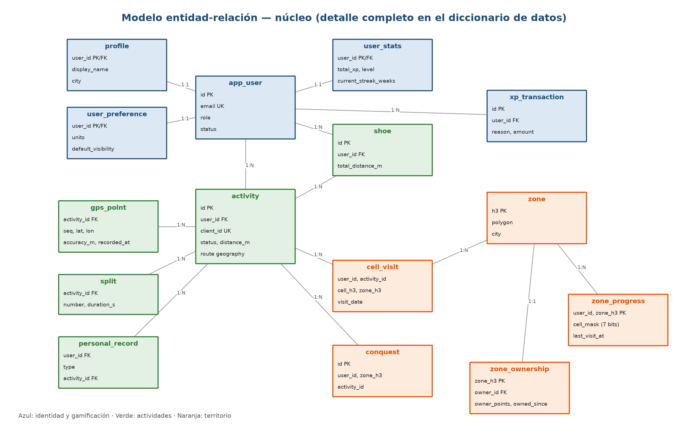

# Control del documento

| Versión | Fecha | Descripción | Responsable |
|---|---|---|---|
| 1.0 | 11/11/2026 | Versión inicial: modelo de datos, contrato de API, algoritmos y estructura de código | Ashley (Scrum Master) |
| 1.1 | 11/11/2026 | Barrios (D-13): tablas `neighborhood` y `neighborhood_ruler`, columna `zone.neighborhood_id`, 4 endpoints, algoritmo del rey o reina, pantalla P-34 | Ashley |

Este documento detalla la implementación del diseño descrito en el **HLD v1.0**. Las decisiones de arquitectura, alcance y prioridades se justifican allí; aquí se especifica *cómo* se construye.

**Convención de idioma:** todos los identificadores técnicos (código, tablas, columnas, rutas, JSON, códigos de error) están en **inglés**; las explicaciones, en español. El glosario que relaciona cada concepto del dominio con su nombre en el código está en `docs/04-ESTANDARES-DESARROLLO.md` §1.3.

# 1. Estructura del código

## 1.1 Repositorio

```text
terrun/
├── backend/          .NET 10 API (Ashley)
├── mobile/           React Native + Expo app (Jorge, Rowlis)
├── docs/             HLD, LLD, backlog, estado, bitácora, QA
├── scripts/          utilidades (diagramas, documentos, configuración)
└── .github/          CI, plantillas de issue y de PR
```

Ramas: `main` protegida (solo por PR con 1 aprobación y CI en verde). Ramas de trabajo `feat/CTZ-<n>-short-description`, `fix/...`, `docs/...`, `chore/...`. Commits en inglés con formato Conventional Commits y ámbitos `api`, `db`, `engine`, `territory`, `auth`, `social`, `app`, `gps`, `map`, `ui`, `qa`, `docs`, `ci`.

## 1.2 Backend (.NET 10)

```text
backend/
├── Terrun.sln
├── src/
│   ├── Terrun.Api/              host: Program.cs, middleware, Swagger, DI
│   │   ├── Modules/
│   │   │   ├── Identity/                 Controllers, Services, Contracts, Validators
│   │   │   ├── Profile/
│   │   │   ├── Activities/
│   │   │   ├── Territory/
│   │   │   ├── Social/
│   │   │   ├── Clubs/
│   │   │   ├── Gamification/
│   │   │   ├── Leaderboards/
│   │   │   ├── Notifications/
│   │   │   ├── Moderation/
│   │   │   └── System/                   settings, health, legal documents
│   │   └── Jobs/                         background services (§6)
│   ├── Terrun.Domain/           entities, enums, domain exceptions
│   ├── Terrun.Infrastructure/   DbContext, EF configurations, migrations,
│   │                                     email, push, R2 storage, Google/Apple auth
│   └── Terrun.Engine/           PURE library (no EF, no HTTP):
│       ├── Geo/                          haversine, densify, simplify
│       ├── Metrics/                      distance, pace, elevation, calories, splits, records
│       ├── AntiCheat/                    rules and verdict
│       ├── Territory/                    H3, cell mask, conquest, ownership
│       └── Progression/                  XP, level, streaks, achievement rules
└── tests/
    ├── Terrun.Engine.Tests/     unit tests (hand-calculated cases)
    └── Terrun.Api.Tests/        integration tests with Testcontainers (real PostGIS)
```

**Reglas de dependencia:** `Api → Infrastructure → Domain`; `Api → Engine`; `Engine` no depende de ningún otro proyecto. Un módulo no accede directamente a las tablas de otro: usa su servicio (`ITerritoryService`, `IGamificationService`, etc.).

**Patrones:** controladores delgados → servicio de aplicación → EF Core (el `DbContext` actúa como unidad de trabajo); validación con FluentValidation; errores con `ProblemDetails`; opciones tipadas para la configuración; `IClock` inyectable para probar fechas.

## 1.3 App móvil (React Native + Expo)

```text
mobile/
├── app/                                  routes (Expo Router)
│   ├── (auth)/                           welcome, register, login, verify-email, forgot-password
│   ├── (tabs)/                           map, feed, record, clubs, profile
│   ├── activity/[id].tsx                 detail; activity/[id]/edit.tsx
│   ├── zone/[h3].tsx
│   ├── user/[id].tsx
│   ├── club/[id].tsx
│   └── settings/                         preferences, privacy, account, shoes
└── src/
    ├── api/            HTTP client, query hooks, types generated from OpenAPI (openapi-typescript)
    ├── recording/      location task, state machine, auto-pause, voice cues
    ├── storage/        expo-sqlite: local activities and upload queue
    ├── map/            MapLibre, hexagon layer, h3-js for provisional rendering
    ├── components/     design system (buttons, cards, inputs)
    ├── theme/          colors, typography, spacing tokens
    ├── i18n/           es.json (user-facing texts)
    ├── state/          Zustand: session and preferences
    └── utils/          pace, distance and date formatting
```

Los tipos TypeScript de la API se **generan desde el OpenAPI** del backend (`npm run api:types`). Ningún tipo de la API se escribe a mano: así se mantienen sincronizados los dos lados del contrato.

# 2. Modelo de datos

## 2.1 Convenciones

- PostgreSQL 16 con las extensiones `postgis`, `citext` y `pgcrypto`.
- Tablas en singular y `snake_case`; las convenciones completas están en `docs/04-ESTANDARES-DESARROLLO.md` §2.3.
- Claves primarias `uuid` (`gen_random_uuid()`), salvo las tablas de alto volumen (`bigint` identity) y las zonas (índice H3 `bigint`).
- Fechas `timestamptz` en UTC con sufijo `_at`. Distancias en metros, tiempos en segundos, ritmos en segundos por km.
- Geometrías en `geography` (SRID 4326).
- Enumeraciones como tipos `enum` de PostgreSQL, mapeados a enums de C#.
- Toda tabla mutable tiene `created_at`; las editables, además, `updated_at`.

## 2.2 Diagrama entidad-relación (núcleo)



## 2.3 Diccionario de datos

### M1 — Identidad y cuenta

| Tabla | Columnas | Restricciones e índices |
|---|---|---|
| `app_user` | `id uuid`, `email citext`, `is_email_verified bool`, `password_hash text null`, `role user_role` (runner, moderator, admin), `status user_status` (active, suspended, deleted), `last_login_at`, `deleted_at`, `created_at`, `updated_at` | PK `id`; UK `email`; `password_hash` nulo solo si existe un `external_login` |
| `external_login` | `id uuid`, `user_id uuid`, `provider login_provider` (google, apple), `subject text` (claim `sub`), `email citext`, `created_at` | FK → app_user (cascade); UK (`provider`, `subject`) |
| `refresh_token` | `id uuid`, `user_id uuid`, `token_hash bytea` (SHA-256), `family_id uuid`, `expires_at`, `revoked_at`, `replaced_by uuid`, `ip inet`, `device text`, `created_at` | UK `token_hash`; índice (`user_id`, `revoked_at`) |
| `verification_token` | `id uuid`, `user_id uuid`, `type token_type` (email_verification, password_reset), `token_hash bytea`, `expires_at`, `used_at`, `created_at` | UK `token_hash`; vigencia de 24 h (verificación) y 1 h (restablecimiento) |
| `legal_document` | `id uuid`, `type legal_document_type` (terms, privacy), `version text`, `url text`, `effective_from timestamptz` | UK (`type`, `version`) |
| `consent` | `id uuid`, `user_id uuid`, `legal_document_id uuid`, `accepted_at`, `ip inet` | UK (`user_id`, `legal_document_id`) |

### M2 — Perfil y preferencias

| Tabla | Columnas | Restricciones e índices |
|---|---|---|
| `profile` | `user_id uuid`, `display_name varchar(60)`, `handle citext` (@user), `photo_url text`, `bio varchar(300)`, `city varchar(80)`, `country char(2)`, `birth_date date`, `sex sex` (female, male, other, undisclosed), `weight_kg numeric(5,2)`, `height_cm smallint`, `is_private bool`, `updated_at` | PK/FK `user_id`; UK `handle`; CHECK `weight_kg` entre 25 y 300 |
| `user_preference` | `user_id uuid`, `units unit_system` (metric, imperial), `default_visibility visibility` (public, followers, private), `is_auto_pause_enabled bool`, `is_voice_cues_enabled bool`, `voice_cue_interval_km numeric(4,2)`, `notify_zone_stolen bool`, `notify_kudos bool`, `notify_comments bool`, `notify_followers bool`, `notify_challenges bool`, `updated_at` | PK/FK `user_id`; por defecto: metric, followers, auto-pausa activada, avisos cada 1 km |
| `privacy_zone` | `id uuid`, `user_id uuid`, `name varchar(40)`, `center geography(Point)`, `radius_m smallint`, `created_at` | CHECK `radius_m` entre 100 y 1000; máximo 5 por usuario |
| `user_stats` | `user_id uuid`, `total_distance_m bigint`, `total_time_s bigint`, `total_activities int`, `zones_conquered int`, `zones_owned int`, `total_steals int`, `total_xp int`, `level smallint`, `current_streak_weeks smallint`, `longest_streak_weeks smallint`, `last_activity_at` | PK/FK `user_id`; tabla desnormalizada que actualiza el procesador; acelera perfiles y rankings |

### M3 — Actividades

| Tabla | Columnas | Restricciones e índices |
|---|---|---|
| `activity` | `id uuid`, `user_id uuid`, `client_id uuid`, `type activity_type` (run, jog, walk), `title varchar(80)`, `description varchar(500)`, `visibility visibility`, `status activity_status` (pending, processing, processed, in_review, rejected, failed), `status_reason text`, `started_at`, `ended_at`, `elapsed_time_s int`, `moving_time_s int`, `distance_m numeric(10,2)`, `avg_pace_s_per_km int`, `max_speed_mps numeric(5,2)`, `elevation_gain_m numeric(7,1)`, `elevation_loss_m numeric(7,1)`, `calories int`, `route geography(LineString)` (simplificada), `shoe_id uuid null`, `new_zones smallint`, `xp_earned int`, `attempts smallint`, `device text`, `app_version text`, `created_at`, `processed_at`, `updated_at` | UK (`user_id`, `client_id`) → idempotencia; índices (`user_id`, `started_at` desc), parcial (`created_at`) WHERE `status = 'pending'`, GIST (`route`) |
| `gps_point` | `activity_id uuid`, `seq int`, `segment smallint`, `recorded_at timestamptz`, `lat double precision`, `lon double precision`, `altitude_m real`, `accuracy_m real`, `speed_mps real`, `is_discarded bool`, `discard_reason discard_reason` | PK (`activity_id`, `seq`); FK cascade; `segment` cambia en cada pausa |
| `split` | `activity_id uuid`, `number smallint`, `distance_m numeric(7,2)`, `duration_s int`, `pace_s_per_km int`, `elevation_m numeric(6,1)` | PK (`activity_id`, `number`); el último split puede ser parcial |
| `personal_record` | `id uuid`, `user_id uuid`, `type record_type` (km_1, km_5, km_10, half_marathon, marathon, longest), `value numeric(10,2)` (segundos o metros), `activity_id uuid`, `achieved_at` | UK (`user_id`, `type`); conserva el récord vigente |

### M4 — Equipamiento

| Tabla | Columnas | Restricciones e índices |
|---|---|---|
| `shoe` | `id uuid`, `user_id uuid`, `brand varchar(40)`, `model varchar(60)`, `nickname varchar(40)`, `initial_distance_m int`, `total_distance_m bigint`, `retirement_km smallint` (700 por defecto), `is_default bool`, `retired_at`, `created_at` | Índice único parcial (`user_id`) WHERE `is_default` |

### M5 — Territorio

| Tabla | Columnas | Restricciones e índices |
|---|---|---|
| `zone` | `h3 bigint` (res 9), `polygon geography(Polygon)`, `center geography(Point)`, `neighborhood_id uuid null`, `city varchar(80)`, `country char(2)`, `total_conquerors int`, `created_at` | PK `h3`; FK `neighborhood_id`; GIST (`polygon`); se crea bajo demanda y se asigna al barrio que contiene su `center` |
| `neighborhood` | `id uuid`, `name varchar(80)`, `slug citext`, `city varchar(80)`, `country char(2)`, `boundary geography(MultiPolygon)`, `source neighborhood_source` (one, osm, manual), `created_at`, `updated_at` | UK (`country`, `city`, `slug`); GIST (`boundary`) |
| `neighborhood_ruler` | `neighborhood_id uuid`, `ruler_id uuid null`, `zones_owned int`, `ruler_since timestamptz`, `recalculated_at`, `version int` | PK/FK `neighborhood_id`; índice (`ruler_id`) |
| `cell_visit` | `id bigint identity`, `user_id uuid`, `activity_id uuid`, `zone_h3 bigint`, `cell_h3 bigint` (res 10), `position smallint` (0–6), `visit_date date` | UK (`activity_id`, `cell_h3`); índices (`zone_h3`, `visit_date`), (`user_id`, `zone_h3`); base del cálculo de dominio |
| `zone_progress` | `user_id uuid`, `zone_h3 bigint`, `cell_mask smallint` (bits 0–6), `visited_cells smallint` (columna generada: bits en 1), `first_visit_at`, `last_visit_at` | PK (`user_id`, `zone_h3`); CHECK `cell_mask` entre 0 y 127 |
| `conquest` | `id uuid`, `user_id uuid`, `zone_h3 bigint`, `activity_id uuid`, `conquered_at` | UK (`user_id`, `zone_h3`): una conquista por usuario y zona |
| `zone_ownership` | `zone_h3 bigint`, `owner_id uuid null`, `owner_club_id uuid null`, `owner_points int`, `owned_since timestamptz`, `recalculated_at`, `version int` | PK/FK `zone_h3`; índice (`owner_id`); `version` para concurrencia optimista |
| `zone_event` | `id bigint identity`, `zone_h3 bigint`, `type zone_event_type` (ownership_gained, stolen, defended, lost_inactivity, ruler_gained, ruler_lost), `user_id uuid null`, `previous_owner_id uuid null`, `activity_id uuid null`, `points int`, `occurred_at` | Índices (`zone_h3`, `occurred_at` desc), (`previous_owner_id`) |

### M6 — Social

| Tabla | Columnas | Restricciones e índices |
|---|---|---|
| `follow` | `follower_id uuid`, `followee_id uuid`, `status follow_status` (pending, accepted), `created_at`, `accepted_at` | PK (`follower_id`, `followee_id`); CHECK follower ≠ followee; índice (`followee_id`, `status`) |
| `kudos` | `activity_id uuid`, `user_id uuid`, `created_at` | PK (`activity_id`, `user_id`) |
| `comment` | `id uuid`, `activity_id uuid`, `user_id uuid`, `body varchar(500)`, `created_at`, `edited_at`, `deleted_at` | Índice (`activity_id`, `created_at`) |
| `user_block` | `blocker_id uuid`, `blocked_id uuid`, `created_at` | PK (`blocker_id`, `blocked_id`); bloquear elimina el seguimiento en ambos sentidos |
| `report` | `id uuid`, `reporter_id uuid`, `target_type report_target` (user, activity, comment, club), `target_id uuid`, `reason report_reason` (spam, harassment, cheating, inappropriate, other), `details varchar(500)`, `status report_status` (open, in_review, resolved, dismissed), `resolved_by uuid`, `resolution text`, `created_at`, `resolved_at` | Índice (`status`, `created_at`); UK (`reporter_id`, `target_type`, `target_id`) |

### M7 — Clubes

| Tabla | Columnas | Restricciones e índices |
|---|---|---|
| `club` | `id uuid`, `name varchar(60)`, `slug citext`, `description varchar(500)`, `city varchar(80)`, `photo_url text`, `privacy club_privacy` (open, approval_required), `creator_id uuid`, `member_count int`, `created_at`, `updated_at` | UK `slug`; índice (`city`) |
| `club_member` | `club_id uuid`, `user_id uuid`, `role club_role` (admin, member), `status member_status` (pending, active), `joined_at` | PK (`club_id`, `user_id`); al menos un admin activo por club |

### M8 — Gamificación

| Tabla | Columnas | Restricciones e índices |
|---|---|---|
| `xp_transaction` | `id bigint identity`, `user_id uuid`, `reason xp_reason` (distance, conquest, ownership, steal, achievement, challenge, adjustment), `amount int`, `activity_id uuid null`, `reference text`, `created_at` | UK (`user_id`, `reason`, `reference`) → no se otorga dos veces lo mismo |
| `achievement` | `id uuid`, `code varchar(40)`, `name varchar(60)`, `description varchar(200)`, `icon text`, `category achievement_category` (distance, territory, consistency, social, special), `rule jsonb`, `xp int`, `is_active bool`, `sort_order smallint` | UK `code`; ejemplo de `rule`: `{"metric":"zones_conquered","threshold":10}` |
| `user_achievement` | `user_id uuid`, `achievement_id uuid`, `earned_at`, `activity_id uuid null` | PK (`user_id`, `achievement_id`) |
| `challenge` | `id uuid`, `title varchar(80)`, `description varchar(500)`, `metric challenge_metric` (distance_m, activities, zones_conquered, zones_owned), `goal numeric(12,2)`, `starts_at`, `ends_at`, `xp int`, `club_id uuid null`, `created_by uuid`, `is_active bool` | CHECK `ends_at > starts_at`; `club_id` nulo = reto global |
| `challenge_participant` | `challenge_id uuid`, `user_id uuid`, `progress numeric(12,2)`, `joined_at`, `completed_at` | PK (`challenge_id`, `user_id`) |

### M9 — Rankings

| Tabla | Columnas | Restricciones e índices |
|---|---|---|
| `leaderboard_snapshot` | `id bigint identity`, `period leaderboard_period` (week, month), `period_start date`, `metric leaderboard_metric` (zones_owned, zones_conquered, distance_m, xp), `scope leaderboard_scope` (global, city, club), `scope_ref text null`, `user_id uuid`, `rank int`, `value numeric(14,2)`, `created_at` | UK (`period`, `period_start`, `metric`, `scope`, `scope_ref`, `user_id`). El ranking del periodo en curso se calcula en vivo; el snapshot guarda los periodos cerrados |

### M10 — Notificaciones

| Tabla | Columnas | Restricciones e índices |
|---|---|---|
| `push_device` | `id uuid`, `user_id uuid`, `expo_token text`, `platform device_platform` (android, ios), `is_active bool`, `last_used_at`, `created_at` | UK `expo_token` |
| `notification` | `id uuid`, `user_id uuid`, `type notification_type` (zone_stolen, zone_owned, neighborhood_ruler_gained, neighborhood_ruler_lost, kudos, comment, new_follower, follow_request, achievement, challenge_completed, challenge_new, club, system), `title varchar(80)`, `body varchar(200)`, `data jsonb` (enlace interno), `read_at`, `push_sent_at`, `push_attempts smallint`, `created_at` | Índices (`user_id`, `created_at` desc), parcial (`created_at`) WHERE `push_sent_at IS NULL`. Funciona como *outbox* del envío push |

### M12 — Moderación y auditoría

| Tabla | Columnas | Restricciones e índices |
|---|---|---|
| `activity_review` | `id uuid`, `activity_id uuid`, `violated_rules jsonb`, `status review_status` (pending, approved, rejected), `reviewer_id uuid`, `note text`, `created_at`, `resolved_at` | UK `activity_id` |
| `audit_log` | `id bigint identity`, `user_id uuid null`, `action varchar(60)`, `entity varchar(40)`, `entity_id text`, `data jsonb`, `ip inet`, `occurred_at` | Solo inserción: un trigger rechaza UPDATE y DELETE |

### M13 — Configuración

| Tabla | Columnas | Restricciones e índices |
|---|---|---|
| `system_setting` | `key varchar(80)`, `value jsonb`, `description text`, `is_public bool`, `updated_by uuid`, `updated_at` | PK `key`; los parámetros con `is_public = true` se exponen a la app |

**Total: 41 tablas.**

## 2.4 Parámetros iniciales del sistema

| Clave | Valor | Uso |
|---|---|---|
| `territory.zone_resolution` | 9 | Resolución H3 de una zona |
| `territory.conquest_threshold` | 5 | Sub-celdas (de 7) necesarias para conquistar |
| `territory.ownership_window_days` | 30 | Ventana de los puntos de dominio |
| `territory.min_ownership_points` | 3 | Puntos mínimos para ser dueño |
| `territory.densify_step_m` | 10 | Paso de interpolación de la ruta |
| `territory.min_zones_for_ruler` | 3 | Zonas dominadas mínimas para ser rey o reina de un barrio |
| `anticheat.max_accuracy_m` | 30 | Precisión GPS máxima aceptada |
| `anticheat.max_speed_kmh` | 25 | Velocidad máxima de un tramo |
| `anticheat.min_pace_s_per_km` | 150 | Ritmo sostenido sospechoso (2:30 min/km) |
| `anticheat.min_duration_s` | 180 | Duración mínima para sumar territorio |
| `anticheat.max_jump_m` | 200 | Salto máximo en menos de 5 s |
| `activity.max_points` | 30000 | Máximo de puntos por actividad |
| `activity.auto_pause_speed_mps` | 0.5 | Umbral de auto-pausa (lo usa la app) |
| `xp.per_km` | 10 | XP por kilómetro |
| `xp.conquest` | 50 | XP por zona conquistada |
| `xp.ownership` | 30 | XP por obtener el dominio |
| `xp.steal` | 40 | XP por robar una zona |
| `xp.level_curve` | {"base":100,"exponent":1.5} | XP para el nivel n = base × n^exponent |
| `calories.default_weight_kg` | 70 | Peso cuando el perfil no lo tiene |
| `map.max_zones_per_bbox` | 2000 | Máximo de zonas por consulta del mapa |

# 3. Contrato de la API REST

## 3.1 Convenciones

- Base: `https://<host>/api/v1`. JSON en `camelCase`; valores de enums en `snake_case`; unidades en el nombre del campo (`distanceM`, `durationS`). Fechas ISO 8601 en UTC. Convenciones completas en `docs/04-ESTANDARES-DESARROLLO.md` §2.4.
- Autenticación: `Authorization: Bearer <jwt>`, salvo los endpoints marcados como públicos.
- Paginación por cursor: `?cursor=<opaque>&limit=20` (máximo 50). Respuesta: `{ "items": [...], "nextCursor": "..." | null }`.
- Errores en formato RFC 7807 (`application/problem+json`) con la extensión `code`, que es estable (§3.4).
- Límite de tasa: 100 solicitudes/min por usuario; `/auth/*`: 10/min por IP. Al excederlo se responde 429 con `Retry-After`.
- Documentación viva en `/swagger` (OpenAPI 3.1). El OpenAPI es la fuente de los tipos de la app.

## 3.2 Endpoints

Columna **P**: prioridad. **Rol**: `pub` = público, `aut` = cualquier usuario autenticado, `mod` = moderador, `adm` = administrador.

### Identidad y cuenta (M1)

| Método | Ruta | Rol | Descripción | P |
|---|---|---|---|---|
| POST | `/auth/register` | pub | Crea la cuenta (correo, contraseña, aceptación legal) y envía la verificación | P0 |
| POST | `/auth/verify-email` | pub | Confirma el correo con el token recibido | P0 |
| POST | `/auth/resend-verification` | pub | Reenvía el correo de verificación | P0 |
| POST | `/auth/login` | pub | Inicia sesión; devuelve el token de acceso y el refresh token | P0 |
| POST | `/auth/google` | pub | Inicia sesión o registra con un ID token de Google | P1 |
| POST | `/auth/apple` | pub | Inicia sesión o registra con un ID token de Apple | P1 |
| POST | `/auth/refresh` | pub | Rota el refresh token; si se reutiliza uno ya rotado, revoca toda la familia | P0 |
| POST | `/auth/logout` | aut | Revoca el refresh token actual | P0 |
| POST | `/auth/forgot-password` | pub | Envía un correo de restablecimiento (siempre responde 202) | P0 |
| POST | `/auth/reset-password` | pub | Cambia la contraseña con el token y revoca todas las sesiones | P0 |
| PUT | `/me/password` | aut | Cambia la contraseña (requiere la actual) | P1 |
| GET | `/legal/current` | pub | Términos y política de privacidad vigentes | P0 |
| POST | `/me/consents` | aut | Acepta una nueva versión de un documento legal | P0 |
| GET | `/me/export` | aut | Descarga un ZIP con todos los datos del usuario (JSON + GPX) | P1 |
| DELETE | `/me` | aut | Elimina la cuenta (requiere confirmación) | P1 |

### Perfil y preferencias (M2)

| Método | Ruta | Rol | Descripción | P |
|---|---|---|---|---|
| GET | `/me` | aut | Usuario, perfil, preferencias y estadísticas propias | P0 |
| PATCH | `/me/profile` | aut | Actualiza el perfil | P0 |
| POST | `/me/photo/upload-url` | aut | URL firmada de R2 para subir la foto | P1 |
| PUT | `/me/preferences` | aut | Actualiza las preferencias | P0 |
| GET | `/me/privacy-zones` | aut | Lista las zonas de privacidad | P1 |
| POST | `/me/privacy-zones` | aut | Crea una zona de privacidad | P1 |
| DELETE | `/me/privacy-zones/{id}` | aut | Elimina una zona de privacidad | P1 |
| GET | `/users?search=` | aut | Busca usuarios por nombre o @handle | P1 |
| GET | `/users/{id}` | aut | Perfil público con estadísticas (respeta privacidad y bloqueos) | P0 |

### Actividades (M3, M4, M11)

| Método | Ruta | Rol | Descripción | P |
|---|---|---|---|---|
| POST | `/activities` | aut | Sube una actividad completa; idempotente por `clientId` (202) | P0 |
| GET | `/activities/{id}` | aut | Detalle, estado del procesamiento y resultados | P0 |
| PATCH | `/activities/{id}` | aut | Edita título, descripción, tipo, visibilidad y zapatilla (dueño) | P0 |
| DELETE | `/activities/{id}` | aut | Elimina la actividad y recalcula su territorio (dueño) | P0 |
| GET | `/activities/{id}/route` | aut | Ruta en GeoJSON; para terceros se recorta por zonas de privacidad | P0 |
| GET | `/activities/{id}/splits` | aut | Splits por km | P0 |
| GET | `/activities/{id}/gpx` | aut | Exporta la actividad en GPX (dueño) | P1 |
| GET | `/me/activities` | aut | Historial propio (paginado, filtros por tipo y fecha) | P0 |
| GET | `/users/{id}/activities` | aut | Actividades visibles de otro usuario | P1 |
| GET | `/me/summary?period=week\|month\|year` | aut | Totales del periodo y comparación con el anterior | P0 |
| GET | `/me/personal-records` | aut | Récords personales | P1 |
| GET | `/me/shoes` | aut | Lista las zapatillas | P1 |
| POST | `/me/shoes` | aut | Registra una zapatilla | P1 |
| PATCH | `/me/shoes/{id}` | aut | Edita, marca como predeterminada o retira | P1 |
| DELETE | `/me/shoes/{id}` | aut | Elimina una zapatilla sin actividades | P1 |

### Territorio (M5)

| Método | Ruta | Rol | Descripción | P |
|---|---|---|---|---|
| GET | `/zones?bbox=minLon,minLat,maxLon,maxLat` | aut | Zonas del área visible en GeoJSON, con el estado para el usuario | P0 |
| GET | `/zones/{h3}` | aut | Detalle: dueño, puntos, mi progreso (máscara), top 5 de los últimos 30 días | P0 |
| GET | `/zones/{h3}/events` | aut | Historial de robos y dominios de la zona | P1 |
| GET | `/me/territory` | aut | Totales: conquistadas, dominadas, en riesgo de perderse | P0 |
| GET | `/me/conquests` | aut | Zonas conquistadas (paginado, con la actividad que las conquistó) | P0 |
| GET | `/me/owned-zones` | aut | Zonas que domino, con margen de puntos y fecha de vencimiento | P1 |
| GET | `/users/{id}/territory` | aut | Territorio de otro usuario (zonas dominadas) | P1 |
| GET | `/neighborhoods?bbox=` | aut | Barrios del área visible (GeoJSON) con su rey o reina | P1 |
| GET | `/neighborhoods/{id}` | aut | Detalle: rey o reina, top 10 por zonas dominadas, mis zonas en el barrio | P1 |
| GET | `/me/neighborhoods` | aut | Barrios donde tengo zonas, mi posición y los títulos que tengo | P1 |

### Social (M6)

| Método | Ruta | Rol | Descripción | P |
|---|---|---|---|---|
| POST | `/users/{id}/follow` | aut | Sigue o solicita seguir (si el perfil es privado) | P1 |
| DELETE | `/users/{id}/follow` | aut | Deja de seguir o cancela la solicitud | P1 |
| GET | `/users/{id}/followers` | aut | Seguidores | P1 |
| GET | `/users/{id}/following` | aut | Seguidos | P1 |
| GET | `/me/follow-requests` | aut | Solicitudes pendientes | P1 |
| POST | `/me/follow-requests/{userId}/accept` | aut | Acepta una solicitud | P1 |
| POST | `/me/follow-requests/{userId}/reject` | aut | Rechaza una solicitud | P1 |
| GET | `/feed` | aut | Actividades de las personas que sigo y propias (cursor) | P1 |
| POST | `/activities/{id}/kudos` | aut | Da kudos | P1 |
| DELETE | `/activities/{id}/kudos` | aut | Quita el kudos | P1 |
| GET | `/activities/{id}/kudos` | aut | Lista quién dio kudos | P1 |
| GET | `/activities/{id}/comments` | aut | Lista los comentarios | P1 |
| POST | `/activities/{id}/comments` | aut | Comenta | P1 |
| DELETE | `/comments/{id}` | aut | Elimina un comentario (autor o dueño de la actividad) | P1 |
| POST | `/users/{id}/block` | aut | Bloquea | P1 |
| DELETE | `/users/{id}/block` | aut | Desbloquea | P1 |
| GET | `/me/blocked-users` | aut | Lista de bloqueados | P1 |
| POST | `/reports` | aut | Reporta un usuario, actividad, comentario o club | P1 |

### Clubes (M7)

| Método | Ruta | Rol | Descripción | P |
|---|---|---|---|---|
| GET | `/clubs?search=&city=` | aut | Busca clubes | P1 |
| POST | `/clubs` | aut | Crea un club (el creador queda como admin) | P1 |
| GET | `/clubs/{id}` | aut | Detalle con totales | P1 |
| PATCH | `/clubs/{id}` | aut | Edita (admin del club) | P1 |
| DELETE | `/clubs/{id}` | aut | Elimina (admin del club) | P1 |
| POST | `/clubs/{id}/members` | aut | Se une o solicita unirse | P1 |
| DELETE | `/clubs/{id}/members/me` | aut | Abandona el club | P1 |
| GET | `/clubs/{id}/members` | aut | Lista los miembros | P1 |
| PATCH | `/clubs/{id}/members/{userId}` | aut | Aprueba una solicitud o cambia el rol (admin del club) | P1 |
| DELETE | `/clubs/{id}/members/{userId}` | aut | Expulsa a un miembro (admin del club) | P1 |
| GET | `/clubs/{id}/territory` | aut | Zonas dominadas por el club (GeoJSON) | P1 |
| GET | `/me/clubs` | aut | Mis clubes | P1 |

### Gamificación y rankings (M8, M9)

| Método | Ruta | Rol | Descripción | P |
|---|---|---|---|---|
| GET | `/achievements` | aut | Catálogo con el estado propio (obtenido o no, progreso) | P1 |
| GET | `/users/{id}/achievements` | aut | Logros obtenidos por otro usuario | P1 |
| GET | `/me/xp` | aut | Nivel, XP para el siguiente nivel y movimientos de XP | P1 |
| GET | `/challenges?status=active\|upcoming\|finished` | aut | Lista retos (globales y de mis clubes) | P1 |
| GET | `/challenges/{id}` | aut | Detalle con mi progreso | P1 |
| POST | `/challenges/{id}/enrollment` | aut | Se inscribe | P1 |
| DELETE | `/challenges/{id}/enrollment` | aut | Abandona | P1 |
| GET | `/challenges/{id}/standings` | aut | Clasificación del reto | P1 |
| GET | `/leaderboards?metric=&period=&scope=&ref=` | aut | Ranking en vivo (scope: global, city, club, friends) con mi posición | P0 |
| GET | `/leaderboards/history?period=&start=` | aut | Ranking de un periodo cerrado | P1 |

### Notificaciones (M10)

| Método | Ruta | Rol | Descripción | P |
|---|---|---|---|---|
| POST | `/me/devices` | aut | Registra el token push de Expo | P1 |
| DELETE | `/me/devices/{token}` | aut | Elimina el token (al cerrar sesión) | P1 |
| GET | `/me/notifications` | aut | Bandeja (cursor) | P1 |
| GET | `/me/notifications/unread-count` | aut | Contador para el ícono | P1 |
| POST | `/me/notifications/{id}/read` | aut | Marca una como leída | P1 |
| POST | `/me/notifications/read-all` | aut | Marca todas como leídas | P1 |

### Moderación, administración y sistema (M12, M13)

| Método | Ruta | Rol | Descripción | P |
|---|---|---|---|---|
| GET | `/admin/reviews` | mod | Actividades en revisión | P1 |
| POST | `/admin/reviews/{id}/resolve` | mod | Aprueba (la actividad suma territorio) o rechaza | P1 |
| GET | `/admin/reports` | mod | Reportes abiertos | P1 |
| POST | `/admin/reports/{id}/resolve` | mod | Resuelve o descarta; puede ocultar contenido o suspender | P1 |
| POST | `/admin/users/{id}/suspend` | mod | Suspende o reactiva a un usuario | P1 |
| PUT | `/admin/users/{id}/role` | adm | Cambia el rol | P1 |
| GET | `/admin/settings` | adm | Lista los parámetros del sistema | P0 |
| PUT | `/admin/settings/{key}` | adm | Cambia un parámetro (auditado) | P0 |
| GET / POST / PUT / DELETE | `/admin/achievements[/{id}]` | adm | Administra el catálogo de logros | P1 |
| GET / POST / PUT / DELETE | `/admin/challenges[/{id}]` | adm | Administra los retos | P1 |
| GET | `/admin/audit-log` | adm | Consulta la auditoría (filtros por usuario, acción y fecha) | P1 |
| POST | `/admin/legal` | adm | Publica una nueva versión de un documento legal | P1 |
| POST | `/admin/neighborhoods/import` | adm | Carga límites de barrios (GeoJSON) y reasigna las zonas existentes | P1 |
| GET | `/settings/public` | pub | Parámetros que usa la app (auto-pausa, umbral de conquista) | P0 |
| GET | `/health` | pub | Salud de la API y de la base de datos | P0 |

**Total: 116 operaciones** (108 filas, más los cuatro métodos de cada uno de los dos CRUD de administración).

## 3.3 Ejemplos de contrato

**POST `/activities`**

```json
{
  "clientId": "9b2f6a7e-3c1d-4e8b-a1f2-5d6c7b8a9e01",
  "type": "run",
  "startedAt": "2026-11-21T10:02:11Z",
  "endedAt": "2026-11-21T10:41:37Z",
  "shoeId": null,
  "device": "iPhone 13 Pro / iOS 26.1",
  "appVersion": "0.3.0",
  "points": [
    { "seq": 0, "segment": 0, "recordedAt": "2026-11-21T10:02:11Z",
      "lat": 18.47186, "lon": -69.89123, "altitudeM": 21.4, "accuracyM": 6.0, "speedMps": 0.0 },
    { "seq": 1, "segment": 0, "recordedAt": "2026-11-21T10:02:13Z",
      "lat": 18.47191, "lon": -69.89117, "altitudeM": 21.6, "accuracyM": 5.0, "speedMps": 2.9 }
  ]
}
```

Respuestas: `202 Accepted` con `{ "id": "...", "status": "pending" }`; si el `clientId` ya existe, `200 OK` con la actividad existente (idempotencia); `409 ACTIVITY_OVERLAP`; `413 PAYLOAD_TOO_LARGE`; `400 VALIDATION_ERROR`.

**GET `/zones?bbox=-69.95,18.44,-69.88,18.50`**

```json
{
  "type": "FeatureCollection",
  "features": [
    {
      "type": "Feature",
      "geometry": { "type": "Polygon", "coordinates": [[[-69.8912, 18.4718], "..."]] },
      "properties": {
        "h3": "89668d5b2a3ffff",
        "status": "owned_by_me",
        "myProgress": 6,
        "isConquered": true,
        "owner": { "id": "...", "handle": "@ashley", "points": 14 },
        "pointsExpireOn": "2026-12-19"
      }
    }
  ]
}
```

Estados de una zona para el usuario: `free`, `in_progress` (1 a 4 de 7), `conquered` (5 o más, sin dominio), `owned_by_me`, `owned_by_other`. Si el área supera `map.max_zones_per_bbox` zonas, se responde `422 BBOX_TOO_LARGE` y la app pide al usuario acercar el mapa.

## 3.4 Catálogo de errores

| HTTP | `code` | Cuándo |
|---|---|---|
| 400 | `VALIDATION_ERROR` | Datos inválidos; incluye `errors` por campo |
| 401 | `INVALID_CREDENTIALS` | Correo o contraseña incorrectos (mensaje genérico) |
| 401 | `INVALID_TOKEN` | JWT expirado o mal firmado, o refresh token revocado |
| 403 | `EMAIL_NOT_VERIFIED` | Acción que requiere el correo verificado |
| 403 | `FORBIDDEN` | Sin permiso sobre el recurso |
| 403 | `USER_SUSPENDED` | Cuenta suspendida |
| 404 | `NOT_FOUND` | El recurso no existe o no es visible para el usuario (no se distingue, para no filtrar información) |
| 409 | `EMAIL_ALREADY_REGISTERED` | Registro con un correo existente |
| 409 | `HANDLE_TAKEN` | @handle ocupado |
| 409 | `ACTIVITY_OVERLAP` | Se solapa en el tiempo con otra actividad propia |
| 409 | `CONCURRENCY_CONFLICT` | Modificación simultánea del mismo recurso |
| 413 | `PAYLOAD_TOO_LARGE` | Más de `activity.max_points` puntos |
| 422 | `BBOX_TOO_LARGE` | El área del mapa excede el límite |
| 422 | `BUSINESS_RULE_VIOLATION` | Regla violada (por ejemplo, quitar al último admin de un club) |
| 429 | `RATE_LIMITED` | Demasiadas solicitudes |
| 500 | `INTERNAL_ERROR` | Error no controlado (con `traceId` para soporte) |

# 4. Algoritmos

## 4.1 Procesamiento de una actividad

```text
process(activity):
  points = sortBy(activity.points, seq)

  # 1. Cleaning
  for each point p:
    if p.accuracyM > anticheat.max_accuracy_m          -> discard(p, "accuracy")
  for each consecutive pair (a, b) in the same segment:
    d = haversine(a, b);  dt = b.recordedAt - a.recordedAt
    if dt <= 0                                          -> discard(b, "timestamp")
    if d > anticheat.max_jump_m and dt < 5 s            -> discard(b, "jump")
    if d / dt > anticheat.max_speed_kmh                 -> mark leg invalid

  # 2. Metrics (valid points only)
  distanceM      = sum haversine of valid legs within each segment
  movingTimeS    = sum dt of valid legs with speed >= 0.5 m/s
  avgPaceSPerKm  = movingTimeS / (distanceM / 1000)
  elevation      = 5-point moving average of altitude + 3 m hysteresis
  splits         = cut every 1000 m of cumulative distance (interpolating the exact instant)
  calories       = sum MET(leg speed) * weightKg * leg hours
  route          = Douglas-Peucker (5 m tolerance) over valid points

  # 3. Anti-cheat verdict
  if elapsedTimeS < anticheat.min_duration_s           -> processed, no territory
  if avgPaceSPerKm < anticheat.min_pace_s_per_km        -> in_review (creates activity_review)
  if more than 20 % of distance is in invalid legs      -> in_review

  # 4. Territory (only if processed and valid)  -> §4.2
  # 5. Progression: XP, stats, streaks, records, achievements, challenges -> §4.4
  # 6. Notifications -> outbox (notification table)
  everything in ONE transaction; on failure: attempts += 1, status = failed after 3 attempts
```

Tabla MET usada para las calorías (carrera): 8 km/h → 8,3; 9,7 km/h → 9,8; 11,3 km/h → 11,0; 12,9 km/h → 11,8; 14,5 km/h → 12,8; 16,1 km/h → 14,5. Caminata: 5 km/h → 3,5; 6,4 km/h → 5,0. Entre valores se interpola linealmente.

## 4.2 Territorio: de la ruta a la conquista

```text
applyTerritory(activity):
  cells = empty set
  for each valid leg (a, b):
    for each point q interpolated every territory.densify_step_m between a and b:
      cell     = latLngToCell(q, resolution 10)
      zone     = cellToParent(cell, 9)
      position = cellToChildPos(cell, 9)              # 0..6
      cells.add((zone, cell, position))

  for each (zone, cell, position) in cells:
    ensureZone(zone)                                  # INSERT ... ON CONFLICT DO NOTHING
    INSERT cell_visit(user, activity, zone, cell, position, visit_date)
      ON CONFLICT (activity_id, cell_h3) DO NOTHING

  for each touched zone:
    newMask = OR of (1 << position) for this activity's cells in the zone
    UPSERT zone_progress SET cell_mask = cell_mask | newMask
    if popcount(cell_mask) >= territory.conquest_threshold and no conquest(user, zone):
      INSERT conquest; newZones += 1; grant XP conquest
    recalculateOwnership(zone)                        # §4.3
```

**Por qué se usa el índice y no la geometría:** las 7 hijas H3 de un hexágono no cubren exactamente al padre. Por eso la zona de un punto se obtiene con `cellToParent` de su sub-celda y no con una intersección geométrica. Así cada sub-celda pertenece a una única zona, sin ambigüedad.

## 4.3 Dominio de una zona

```text
recalculateOwnership(zone):
  SELECT ... FROM zone_ownership WHERE zone_h3 = zone FOR UPDATE      # lock the row
  points = SELECT user_id, COUNT(*) FROM cell_visit
           WHERE zone_h3 = zone
             AND visit_date >= today - territory.ownership_window_days
             AND activity is valid (processed)
           GROUP BY user_id
  best   = user with most points; tie: current owner keeps it,
           otherwise whoever reached those points first
  if best.points < territory.min_ownership_points: best = none

  if best != current owner:
     type = (current owner == none) ? ownership_gained
          : (best == none)          ? lost_inactivity
          :                           stolen
     INSERT zone_event(type, best, previous owner)
     UPDATE zone_ownership(owner_id = best, owned_since = now, version += 1)
     if stolen: notify(previous owner, "zone_stolen"); grant XP steal to best
     if ownership_gained: grant XP ownership to best
  else if the activity belongs to the owner: INSERT zone_event(defended)
  owner_club = club with most points summed across its active members
```

**Rey o reina del barrio.** Cada vez que una zona cambia de dueño se recalcula su barrio:

```text
recalculateRuler(neighborhood):
  SELECT ... FROM neighborhood_ruler WHERE neighborhood_id = n FOR UPDATE
  counts = SELECT owner_id, COUNT(*) FROM zone_ownership JOIN zone ON zone.h3 = zone_ownership.zone_h3
           WHERE zone.neighborhood_id = n AND owner_id IS NOT NULL GROUP BY owner_id
  best   = owner with most zones; tie: current ruler keeps the title
  if best.zones < territory.min_zones_for_ruler: best = none
  if best != current ruler:
     UPDATE neighborhood_ruler(ruler_id = best, ruler_since = now, version += 1)
     INSERT zone_event(ruler_gained / ruler_lost)
     notify(best, "neighborhood_ruler_gained"); notify(previous, "neighborhood_ruler_lost")
```

Un **trabajo nocturno** (`NightlyOwnershipJob`, 03:00 hora de Santo Domingo) recalcula las zonas cuyo dueño tiene visitas que salen de la ventana ese día. Así se pierde el territorio que no se defiende.

## 4.4 Progresión

- **XP:** cada otorgamiento inserta un `xp_transaction` con una `reference` única (por ejemplo, `conquest:<zone>`), lo que impide duplicarlo. `user_stats.total_xp` se actualiza en la misma transacción.
- **Nivel:** el mayor `n` tal que `base × n^exponent ≤ total_xp` (parámetro `xp.level_curve`).
- **Racha:** semanas ISO consecutivas (en la zona horaria del usuario) con al menos una actividad procesada. Se rompe si una semana completa termina sin actividad.
- **Récords:** ventana deslizante sobre la distancia acumulada para encontrar el menor tiempo en 1, 5, 10, 21,0975 y 42,195 km; `longest` = la mayor distancia.
- **Logros:** después de cada actividad se evalúan las reglas `jsonb` de los logros activos que el usuario todavía no tiene. Métricas soportadas: `total_distance_m`, `activity_distance_m`, `total_activities`, `zones_conquered`, `zones_owned`, `total_steals`, `streak_weeks`, `started_before_hour` y `level`.
- **Retos:** la actividad suma al `progress` de cada participación activa cuya ventana la contiene. Al llegar a la `goal` se fija `completed_at`, se otorga el XP y se notifica.

## 4.5 Eliminación de una actividad o de una cuenta

- **Actividad:** se borran sus visitas; se recalcula el `cell_mask` de `zone_progress` en las zonas afectadas a partir de las visitas restantes; si la zona queda por debajo del umbral, se elimina la conquista; se recalcula el dominio; se revierte su XP con transacciones de tipo `adjustment`.
- **Cuenta:** `status = deleted` y revocación inmediata de las sesiones. `AccountDeletionJob` elimina en 24 h las actividades, puntos, visitas, progreso, conquistas, datos sociales y notificaciones del usuario; recalcula el dominio de sus zonas y anonimiza el registro de `app_user` (el correo se reemplaza por un hash) para conservar la integridad de la auditoría.

# 5. App móvil: diseño detallado

## 5.1 Máquina de estados de la grabación (`RecordingState`)

```text
idle ──start──▶ recording ──pause / auto-pause──▶ paused
                    ▲                                │
                    └──────resume / moving───────────┘
recording | paused ──finish──▶ finished ──save──▶ queued
queued ──online──▶ uploading ──202──▶ uploaded ──poll──▶ processed
uploading ──error──▶ queued (exponential backoff: 5 s, 30 s, 2 min, 10 min)
```

- **Auto-pausa:** velocidad por debajo de 0,5 m/s durante 10 s → pausa; por encima de 1 m/s → reanuda. Cada pausa abre un `segment` nuevo.
- **Frecuencia del GPS:** precisión `BestForNavigation`, intervalo de 2 s o distancia de 5 m.
- **Android:** servicio en primer plano con la notificación "Grabando carrera · 3,2 km · 18:45" y permiso de ubicación *mientras se usa*.
- **iOS:** `UIBackgroundModes: location`, indicador azul de ubicación y `pausesUpdatesAutomatically = false` durante la grabación.
- **Persistencia:** cada punto se escribe en SQLite en cuanto llega. Si el sistema mata la app, al reabrirla se ofrece reanudar o finalizar la actividad.
- **Métricas en vivo:** la app las calcula solo para mostrarlas; las oficiales son las del servidor.
- **Avisos de voz:** cada `voiceCueIntervalKm` se leen la distancia, el tiempo y el ritmo del último km (expo-speech).

## 5.2 Pantallas y responsables

| ID | Pantalla (ruta) | Endpoints principales | Responsable | P |
|---|---|---|---|---|
| P-01 | Bienvenida (`(auth)/welcome`) | `/legal/current` | Rowlis | P0 |
| P-02 | Registro (`(auth)/register`) | `/auth/register` | Rowlis | P0 |
| P-03 | Inicio de sesión (`(auth)/login`) | `/auth/login`, `/auth/google`, `/auth/apple` | Rowlis | P0 |
| P-04 | Verificar correo (`(auth)/verify-email`) | `/auth/verify-email`, `/auth/resend-verification` | Rowlis | P0 |
| P-05 | Recuperar contraseña (`(auth)/forgot-password`) | `/auth/forgot-password`, `/auth/reset-password` | Rowlis | P0 |
| P-06 | Permisos: ubicación y notificaciones (`onboarding/permissions`) | `/me/devices` | Jorge | P0 |
| P-07 | Mapa de territorio, inicio (`(tabs)/map`) | `/zones`, `/me/territory` | Jorge | P0 |
| P-08 | Grabar actividad (`(tabs)/record`) | `/settings/public`, `/me/shoes` | Jorge | P0 |
| P-09 | Resumen al terminar (`activity/[id]/summary`) | `/activities/{id}` | Jorge | P0 |
| P-10 | Historial (`profile/activities`) | `/me/activities`, `/me/summary` | Rowlis | P0 |
| P-11 | Detalle de actividad (`activity/[id]`) | `/activities/{id}`, `/route`, `/splits`, `/kudos`, `/comments` | Jorge (mapa y splits) / Rowlis (social) | P0 |
| P-12 | Editar actividad (`activity/[id]/edit`) | `PATCH`/`DELETE /activities/{id}`, `/gpx` | Rowlis | P0 |
| P-13 | Detalle de zona (`zone/[h3]`) | `/zones/{h3}`, `/zones/{h3}/events` | Jorge | P0 |
| P-14 | Feed (`(tabs)/feed`) | `/feed` | Rowlis | P1 |
| P-15 | Mi perfil (`(tabs)/profile`) | `/me`, `/me/personal-records`, `/me/owned-zones` | Rowlis | P0 |
| P-16 | Perfil de otro usuario (`user/[id]`) | `/users/{id}`, `/activities`, `/territory`, `/achievements`, `/follow`, `/block` | Rowlis | P1 |
| P-17 | Editar perfil (`settings/profile`) | `PATCH /me/profile`, `/me/photo/upload-url` | Rowlis | P0 |
| P-18 | Seguidores, seguidos y solicitudes (`user/[id]/followers`) | `/followers`, `/following`, `/me/follow-requests` | Rowlis | P1 |
| P-19 | Buscar (`search`) | `/users?search=`, `/clubs?search=` | Rowlis | P1 |
| P-20 | Clubes (`(tabs)/clubs`) | `/clubs`, `/me/clubs` | Rowlis | P1 |
| P-21 | Detalle de club (`club/[id]`) | `/clubs/{id}`, `/members`, `/territory`, `/leaderboards?scope=club` | Rowlis (+ Jorge en el mapa) | P1 |
| P-22 | Crear o editar club (`club/edit`) | `POST`/`PATCH /clubs` | Rowlis | P1 |
| P-23 | Rankings (`leaderboards`) | `/leaderboards`, `/leaderboards/history` | Rowlis | P0 |
| P-24 | Logros y nivel (`achievements`) | `/achievements`, `/me/xp` | Rowlis | P1 |
| P-25 | Retos (`challenges`) | `/challenges` | Rowlis | P1 |
| P-26 | Detalle de reto (`challenge/[id]`) | `/challenges/{id}`, `/enrollment`, `/standings` | Rowlis | P1 |
| P-27 | Notificaciones (`notifications`) | `/me/notifications`, `/unread-count`, `/read`, `/read-all` | Rowlis | P1 |
| P-28 | Zapatillas (`settings/shoes`) | `/me/shoes` | Rowlis | P1 |
| P-29 | Récords y estadísticas (`profile/records`) | `/me/personal-records`, `/me/summary` | Rowlis | P1 |
| P-30 | Preferencias (`settings/preferences`) | `PUT /me/preferences` | Rowlis | P0 |
| P-31 | Privacidad y zonas de privacidad (`settings/privacy-zones`) | `/me/privacy-zones`, `/me/blocked-users` | Jorge | P1 |
| P-32 | Cuenta (`settings/account`) | `/me/password`, `/me/export`, `DELETE /me`, `/me/consents` | Rowlis | P1 |
| P-33 | Reportar, modal (`report`) | `/reports` | Rowlis | P1 |
| P-34 | Detalle de barrio (`neighborhood/[id]`) y capa de barrios en P-07 | `/neighborhoods`, `/neighborhoods/{id}`, `/me/neighborhoods` | Jorge (capa del mapa) / Rowlis (pantalla) | P1 |
| ADM | Moderación y administración | `/admin/*` (vía Swagger durante el curso) | Ashley | P1 |

# 6. Trabajos en segundo plano

| Trabajo | Frecuencia | Qué hace |
|---|---|---|
| `ActivityProcessorJob` | Continuo (sondeo cada 2 s, lotes de 5) | Toma actividades `pending` con `FOR UPDATE SKIP LOCKED` y ejecuta §4.1 |
| `PushDispatchJob` | Cada 5 s | Envía las notificaciones sin `push_sent_at` a Expo Push; desactiva los tokens inválidos; hasta 5 intentos |
| `NightlyOwnershipJob` | Diario, 03:00 (AST) | Recalcula las zonas cuyos puntos vencen ese día |
| `StreakJob` | Lunes, 00:10 (zona del usuario) | Cierra la semana y actualiza las rachas |
| `LeaderboardSnapshotJob` | Lunes 00:05 y día 1 de cada mes | Guarda el ranking del periodo cerrado |
| `ChallengeCloseJob` | Cada hora | Cierra los retos vencidos y notifica los resultados |
| `AccountDeletionJob` | Cada hora | Ejecuta las eliminaciones de cuenta pendientes (§4.5) |
| `TokenCleanupJob` | Diario | Borra refresh tokens y tokens de verificación vencidos |

Implementación: `BackgroundService` de .NET con programación cron (librería Cronos). Cada trabajo registra su inicio, su fin y sus errores en el log estructurado.

# 7. Seguridad detallada

## 7.1 Autenticación

- **Contraseña:** PBKDF2-HMAC-SHA512, 210.000 iteraciones, sal de 16 bytes. Mínimo 10 caracteres; se rechazan las 10.000 contraseñas más comunes.
- **JWT de acceso:** HS256 (clave de 256 bits por variable de entorno), 15 minutos. Claims: `sub`, `role`, `sv` (versión de seguridad: cambia al cambiar la contraseña o el rol e invalida los tokens anteriores).
- **Refresh token:** 32 bytes aleatorios; se guarda solo su SHA-256; 30 días; se rota en cada uso. Si se reutiliza un token ya rotado, se revoca toda la `family_id` (posible robo).
- **Google / Apple:** se valida la firma con las JWKS del proveedor, `aud` = el client id de la app, `iss` y `exp`. Si el correo coincide con una cuenta existente con correo verificado, se vinculan.
- **En el teléfono:** los tokens se guardan en `expo-secure-store` (Keychain / Keystore), nunca en AsyncStorage.

## 7.2 Autorización y visibilidad

| Recurso | Quién puede verlo |
|---|---|
| Actividad `public` | Todos los usuarios autenticados, excepto los bloqueados en cualquiera de los dos sentidos |
| Actividad `followers` | El dueño y sus seguidores con estado `accepted` |
| Actividad `private` | Solo el dueño (sigue sumando territorio) |
| Ruta de una actividad, vista por terceros | Se recortan los puntos dentro de las zonas de privacidad del dueño |
| Perfil privado | Nombre, foto y nivel para todos; el resto solo para seguidores aceptados |
| Territorio (dueño de una zona) | Público, porque es la mecánica del juego. Solo se muestran el @handle y los puntos |
| Endpoints `/admin/*` | Según el rol (`moderator` o `admin`), verificado con políticas de autorización |

Toda consulta por `id` verifica la propiedad o la visibilidad dentro de la misma consulta SQL (no después), para evitar fugas de información y referencias directas inseguras (IDOR).

## 7.3 Otros controles

- Validación de todas las entradas (FluentValidation) y límites de tamaño de los cuerpos (2 MB en general, 8 MB para `POST /activities`).
- CORS cerrado (la app nativa no lo necesita; Swagger solo en QA).
- Cabeceras de seguridad; HSTS en producción.
- Los logs no registran coordenadas, tokens ni contraseñas.
- Escaneo de dependencias (Dependabot) y de secretos en la CI.
- Se registran en `audit_log`: inicio de sesión (éxito y fallo), cambio y restablecimiento de contraseña, eliminación de cuenta, cambio de rol, suspensión, resolución de reportes y revisiones, y cambios de parámetros.

# 8. Configuración y observabilidad

| Variable de entorno | Descripción |
|---|---|
| `ConnectionStrings__Db` | Cadena de conexión de PostgreSQL (Neon) |
| `Jwt__Key`, `Jwt__Issuer`, `Jwt__Audience` | Firma y validación del JWT |
| `Google__ClientIds` | Client IDs de Android, iOS y web |
| `Apple__ClientId`, `Apple__TeamId` | Validación de Sign in with Apple |
| `Email__ApiKey`, `Email__Sender` | Proveedor de correo |
| `Expo__AccessToken` | Envío de push |
| `R2__Endpoint`, `R2__AccessKey`, `R2__SecretKey`, `R2__Bucket` | Almacenamiento de fotos |
| `App__DeepLinkBaseUrl` | Base de los enlaces de verificación (deep link `terrun://`) |

- **Logs:** Serilog en JSON con `traceId` por solicitud.
- **Salud:** `/health` comprueba la API y la BD; Render la usa como health check.
- **Métricas:** duración del procesamiento por actividad y tamaño de la cola de pendientes, en el log y en el panel de Render.

# 9. Pruebas obligatorias del motor

Cada caso se calcula a mano y se documenta con su entrada y su resultado esperado en `docs/qa/04-CASOS/`. En el código, cada prueba lleva el atributo `[Trait("Case", "MT-NN")]`.

| ID | Caso | Resultado esperado |
|---|---|---|
| MT-01 | Dos puntos separados exactamente 1 km (fórmula de Haversine) | 1000 m ± 0,5 m |
| MT-02 | Punto con precisión de 45 m | Descartado, no suma distancia |
| MT-03 | Tramo a 40 km/h | Tramo inválido: no suma distancia ni territorio |
| MT-04 | Ritmo promedio de 2:10 min/km durante 20 min | Actividad `in_review` |
| MT-05 | Actividad de 2 min | Procesada, sin territorio |
| MT-06 | Ruta que recorre 4 sub-celdas de una zona | `in_progress` 4/7, sin conquista |
| MT-07 | Segunda actividad que suma 1 sub-celda nueva a la zona de MT-06 | Conquista (5/7), +50 XP, `newZones = 1` |
| MT-08 | Repetir exactamente la misma ruta de MT-07 | Sin conquista nueva; la máscara no cambia |
| MT-09 | Subir dos veces la misma actividad (mismo `clientId`) | Una sola actividad, sin efectos duplicados |
| MT-10 | El usuario B supera los puntos de A en una zona dominada por A | Evento `stolen`, dueño = B, notificación a A, +40 XP para B |
| MT-11 | Empate de puntos entre el dueño A y el retador B | A conserva el dominio |
| MT-12 | Las visitas del dueño salen de la ventana de 30 días | Evento `lost_inactivity` (o `stolen` si otro supera el mínimo) |
| MT-13 | Eliminar la actividad que produjo una conquista | Conquista revertida; dominio recalculado; XP ajustado |
| MT-14 | Actividad con una pausa de 10 min (dos segmentos) | No suma distancia entre segmentos; el tiempo en movimiento excluye la pausa |
| MT-15 | Splits de una carrera de 5,4 km | 5 splits completos + 1 parcial de 400 m |
| MT-16 | Récord de 5 km dentro de una carrera de 10 km | Se detecta la ventana de 5 km más rápida |
| MT-17 | Nivel con `total_xp` exactamente en un límite de la curva | Nivel correcto en el límite |
| MT-18 | Punto en una sub-celda cuyo padre geométrico parece ser otra zona | La zona se asigna por `cellToParent` |
| MT-19 | A domina 3 zonas de Naco y B le roba una (B queda con 1) | A pierde el título (2 < 3 mínimo): evento `ruler_lost` |
| MT-20 | Empate de zonas dominadas entre el rey actual y un retador | El rey actual conserva el título |

# 10. Matriz de trazabilidad: tabla → endpoint → pantalla

Ninguna tabla queda sin uso: cada una se escribe o se lee desde al menos un endpoint o un trabajo, y se muestra en al menos una pantalla.

| Tabla | Escriben | Leen | Pantallas |
|---|---|---|---|
| `app_user` | `/auth/register`, `/auth/google`, `/auth/apple`, `DELETE /me`, `/admin/users/*` | `/me`, `/users/{id}` | P-02, P-03, P-15, P-32 |
| `external_login` | `/auth/google`, `/auth/apple` | `/auth/google`, `/auth/apple`, `/me` | P-03, P-32 |
| `refresh_token` | `/auth/login`, `/auth/refresh`, `/auth/logout`, `/auth/reset-password` | `/auth/refresh` | P-03 (sesión) |
| `verification_token` | `/auth/register`, `/auth/forgot-password`, `/auth/resend-verification` | `/auth/verify-email`, `/auth/reset-password` | P-04, P-05 |
| `legal_document` | `/admin/legal` | `/legal/current` | P-01, P-02, P-32 |
| `consent` | `/auth/register`, `/me/consents` | `/me`, `/me/export` | P-02, P-32 |
| `profile` | `/auth/register`, `PATCH /me/profile`, `/me/photo/upload-url` | `/me`, `/users/{id}`, `/users?search=` | P-15, P-16, P-17, P-19 |
| `user_preference` | `PUT /me/preferences` | `/me`, `ActivityProcessorJob` (visibilidad por defecto), `PushDispatchJob` | P-08, P-30 |
| `privacy_zone` | `/me/privacy-zones` | `/activities/{id}/route`, `/feed` | P-31, P-11 |
| `user_stats` | `ActivityProcessorJob`, `StreakJob` | `/me`, `/users/{id}`, `/leaderboards` | P-15, P-16, P-23, P-24 |
| `activity` | `POST`/`PATCH`/`DELETE /activities`, `ActivityProcessorJob` | `/activities/{id}`, `/me/activities`, `/feed` | P-09, P-10, P-11, P-12, P-14 |
| `gps_point` | `POST /activities` | `ActivityProcessorJob`, `/activities/{id}/gpx`, `/me/export` | P-12 (GPX), P-32 |
| `split` | `ActivityProcessorJob` | `/activities/{id}/splits` | P-09, P-11 |
| `personal_record` | `ActivityProcessorJob` | `/me/personal-records`, `/users/{id}` | P-15, P-29 |
| `shoe` | `/me/shoes`, `ActivityProcessorJob` (km acumulados) | `/me/shoes`, `/activities/{id}` | P-08, P-12, P-28 |
| `zone` | `ActivityProcessorJob` (bajo demanda), `/admin/neighborhoods/import` (barrio) | `/zones`, `/zones/{h3}` | P-07, P-13 |
| `neighborhood` | `/admin/neighborhoods/import` | `/neighborhoods`, `/neighborhoods/{id}`, `/me/neighborhoods` | P-07, P-13, P-34 |
| `neighborhood_ruler` | `ActivityProcessorJob`, `NightlyOwnershipJob` | `/neighborhoods`, `/neighborhoods/{id}`, `/me/neighborhoods` | P-07, P-34, P-27 |
| `cell_visit` | `ActivityProcessorJob` | Cálculo de dominio, `/zones/{h3}` (top 5) | P-13 |
| `zone_progress` | `ActivityProcessorJob` | `/zones` (`myProgress`), `/zones/{h3}` | P-07, P-13 |
| `conquest` | `ActivityProcessorJob` | `/me/conquests`, `/me/territory`, `/activities/{id}` | P-09, P-15 |
| `zone_ownership` | `ActivityProcessorJob`, `NightlyOwnershipJob` | `/zones`, `/me/owned-zones`, `/users/{id}/territory`, `/clubs/{id}/territory`, `/leaderboards` | P-07, P-13, P-15, P-16, P-21, P-23 |
| `zone_event` | `ActivityProcessorJob`, `NightlyOwnershipJob` | `/zones/{h3}/events` | P-13, P-27 |
| `follow` | `/users/{id}/follow`, `/me/follow-requests/*` | `/feed`, `/followers`, `/following`, visibilidad, `/leaderboards?scope=friends` | P-14, P-16, P-18, P-23 |
| `kudos` | `/activities/{id}/kudos` | `/activities/{id}/kudos`, `/feed` | P-11, P-14 |
| `comment` | `/activities/{id}/comments`, `DELETE /comments/{id}` | `/activities/{id}/comments` | P-11 |
| `user_block` | `/users/{id}/block` | `/me/blocked-users`, todas las reglas de visibilidad | P-16, P-31 |
| `report` | `/reports` | `/admin/reports` | P-33, ADM |
| `club` | `/clubs` | `/clubs`, `/clubs/{id}`, `/me/clubs` | P-20, P-21, P-22 |
| `club_member` | `/clubs/{id}/members*` | `/clubs/{id}/members`, dominio de club, `/leaderboards?scope=club` | P-21, P-23 |
| `xp_transaction` | `ActivityProcessorJob`, `ChallengeCloseJob` | `/me/xp` | P-09, P-24 |
| `achievement` | `/admin/achievements` | `/achievements` | P-24 |
| `user_achievement` | `ActivityProcessorJob` | `/achievements`, `/users/{id}/achievements` | P-09, P-16, P-24 |
| `challenge` | `/admin/challenges` | `/challenges`, `/challenges/{id}` | P-25, P-26 |
| `challenge_participant` | `/challenges/{id}/enrollment`, `ActivityProcessorJob` | `/challenges/{id}`, `/challenges/{id}/standings` | P-25, P-26 |
| `leaderboard_snapshot` | `LeaderboardSnapshotJob` | `/leaderboards/history` | P-23 |
| `push_device` | `/me/devices` | `PushDispatchJob` | P-06 |
| `notification` | `ActivityProcessorJob`, social, clubes, retos | `/me/notifications`, `PushDispatchJob` | P-27 |
| `activity_review` | `ActivityProcessorJob` | `/admin/reviews` | P-09 (aviso "en revisión"), ADM |
| `audit_log` | Acciones sensibles (§7.3) | `/admin/audit-log` | ADM |
| `system_setting` | `/admin/settings/{key}` | `ActivityProcessorJob`, `/settings/public` | P-08, P-13, ADM |
